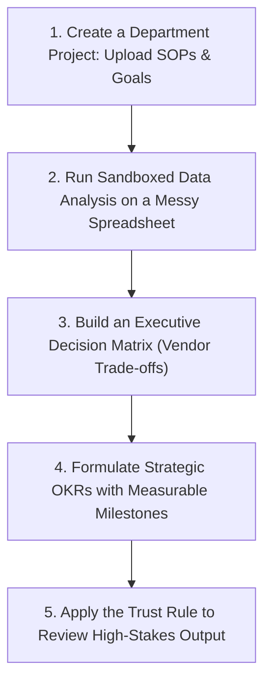

# Onboarding Guide: Business Professionals & Operations

<div class="doc-header-badges">
  <span class="badge badge-surface">Platform: Web · Desktop</span>
  <span class="badge badge-level">Level: Level 2 (Intermediate)</span>
  <span class="badge badge-verified">Last Verified: November 2026</span>
</div>

> [!NOTE]
> **Learning Objectives:** Learn how to deploy Claude Projects for team knowledge management, clean and analyze messy spreadsheets using the sandboxed Analysis Tool, draft executive-ready memos, and evaluate vendor proposals with structured trade-off matrices.

---

## Who This Path Is For

This onboarding guide is tailored for **business managers, operations leads, business analysts, department heads, project managers, and executives**.

In business operations, your highest-value work involves synthesizing scattered information across teams, evaluating operational trade-offs, and communicating decisions clearly. Claude serves as your operational force multiplier—helping you turn raw spreadsheets into board-ready insights, draft strategic OKRs, and maintain persistent departmental guidelines.

---

## Recommended Claude Features & Workflows

| Capability | What It Does for Business Leaders | Where to Access |
| :--- | :--- | :--- |
| **Claude Projects** | Organizes chats inside a shared workspace with up to 200,000 tokens of persistent reference files (SOPs, style guides, org charts). | Left Sidebar > Projects (Pro / Team / Enterprise) |
| **Analysis Tool** | Runs an isolated code execution environment to clean CSV/Excel files, compute statistical metrics, and render downloadable charts. | Composer (automatically invoked on data queries) |
| **Custom Writing Styles** | Enforces an executive, concise, or board-ready tone across all departmental drafts. | Composer > "Use style" dropdown |
| **Multi-Doc Synthesis** | Cross-references multiple vendor quotes, SLAs, or compliance documents simultaneously. | Composer > Attach multiple files (paperclip) |

---

## Step-by-Step Beginner Activities ("Your Path, Top Down")



### Step 1: Create a Dedicated Department Project
Do not keep all company operations in one generic chat. Click **Projects** in the left sidebar, create a project (e.g., *"Q3 Operations & Vendor Management"*), and upload your team's core SOPs, vendor contracts, and budget constraints into **Project Knowledge**.

### Step 2: Use the Analysis Tool for Number-Crunching
When reviewing customer churn, expenses, or inventory, upload the raw CSV or Excel sheet. Specifically instruct Claude to *"use the analysis tool to calculate exact figures"* rather than estimating arithmetic in text.

### Step 3: Enforce Executive Formatting
Always instruct Claude to present business trade-offs in structured tables with explicit criteria: **Cost, Implementation Timeline, Risk Level, and Recommendation**.

---

## Practical Examples & Copy-Ready Prompts

### Example 1: The Executive Decision Matrix (Vendor Selection)
Use this prompt when evaluating competing software proposals, suppliers, or agency bids.

```xml
<context>
I am reviewing three proposals for our company's new cloud inventory management system.
- Vendor A (CloudLogix): $45,000/yr, 4-month implementation, native ERP integration, 24/7 dedicated phone support.
- Vendor B (StockFlow): $28,000/yr, 6-week implementation, requires custom API middleware ($8,000 one-time), email-only support.
- Vendor C (EnterprisePrime): $62,000/yr, 6-month implementation, full white-glove migration included, guaranteed 99.99% SLA.
Our annual budget ceiling is $50,000, and our warehouse expansion goes live in 3 months.
</context>

<instructions>
Act as a Senior Operations Director.
1. Create a comparative Markdown table with columns: Vendor, Year 1 Total Cost, Implementation Time, Fit with Expansion Timeline, Support Tier, and Key Risk.
2. Provide a 2-paragraph Executive Recommendation explaining which vendor we should select, specifically addressing our 3-month deadline and budget constraint.
3. List three critical negotiation levers we should press during contracting.
</instructions>
```

#### Expected Result:
Claude returns a clean comparison matrix highlighting that Vendor B ($36,000 total Year 1) fits both the 3-month deadline (6 weeks) and budget, while identifying email-only support as the primary operational risk to mitigate.

---

### Example 2: Financial Spreadsheets & Churn Analysis (Analysis Tool)

```xml
<context>
[Attach monthly_churn_data.csv]
The attached CSV contains 12 months of customer subscription data across our Starter, Professional, and Enterprise tiers.
</context>

<instructions>
Using the built-in analysis tool:
1. Calculate the average monthly churn rate for each tier over the past 12 months.
2. Identify which tier experienced the sharpest churn spike and in which quarter.
3. Suggest two operational hypotheses for why that spike occurred.
4. Output a summary table of the annualized metrics.
</instructions>
```

#### Expected Result:
Claude executes sandboxed code to compute exact percentages (e.g., Starter: 4.8%, Pro: 2.1%, Enterprise: 0.6%), graphs the trend, and outputs a formatted table without rounding errors.

---

## Common Mistakes & How to Fix Them

> [!WARNING]
> **Common Mistake: Relying on Text Prediction for Math**
> Asking Claude to *"sum column D and divide by total headcount"* in a conversational prompt without invoking code execution can lead to subtle arithmetic hallucinations.
> **The Fix:** Explicitly write: *"Write and run code using the analysis tool to calculate exact sums."* Always verify high-stakes financial totals.

> [!TIP]
> **Pro Tip: Keep the Project Knowledge Base Curated**
> In accordance with [Part B, Module 7: Context & The Desk](../foundations/part-b/module-07-context.md), uploading 40 obsolete PDF memos will clutter Claude's context desk. Keep your Project Knowledge trimmed to the 5–10 authoritative documents that define current policy.

---

## Limitations & Important Considerations

- **Confidentiality & PII:** Never paste employee performance reviews, unredacted salary figures, or customer social security numbers. Ensure your account is configured to opt out of training (see [02. Getting Started & Setup](../02-getting-started/index.md)).
- **File Upload Limits:** Single files must not exceed 30MB, and you can attach up to 5 documents per individual prompt turn.

---

## Hands-On Exercise: 15-Minute Project Setup

1. Log into [claude.ai](https://claude.ai).
2. Click **Projects** in the left sidebar and select **New Project**.
3. Name it *"Operations Playbook"*.
4. Under **Set Project Instructions**, paste:
   ```text
   You are an Operations Executive Assistant.
   - Always respond in concise, action-oriented bullet points.
   - For any strategic proposal, include a Risk vs. Reward breakdown.
   - Present dates in DD/MM/YYYY format.
   ```
5. Start a new chat within the project and run the **Executive Decision Matrix Prompt** above.

---

## Related Foundational Modules

- [Part A, Module 4: Strengths, Limits & Trust](../foundations/part-a/module-04-strengths-limits-trust.md) — How to check high-stakes business calculations.
- [Part B, Module 7: Context & The Desk](../foundations/part-b/module-07-context.md) — Keeping your workspace uncluttered.
- [Part B, Module 9: Memory & Project Instructions](../foundations/part-b/module-09-memory.md) — Preserving team conventions across sessions.
- [Part B, Module 13: Permissions & Safety](../foundations/part-b/module-13-permissions-and-safety.md) — Guarding confidential business folders.

---

## Related Masterclass Guides

- [07. Data Analysis & Sandboxed Analytics Overview](../07-data-analysis/index.md) — Deep dive into spreadsheet wrangling and charts.
- [09. Claude Projects & Knowledge Bases Overview](../09-projects-and-knowledge-bases/index.md) — Architecture and best practices for 200K token knowledge bases.
- [11. Workplace Playbooks: Management & Operations](../11-workplace-and-industry-playbooks/index.md) — Turnkey templates for 1-on-1s, OKRs, and meeting minutes.

---

## Official References

- [Anthropic Help Center: Using Claude Projects](https://support.anthropic.com/en/articles/9517075-what-are-projects)
- [Anthropic: Analysis Tool & Code Execution](https://support.anthropic.com/en/articles/9985959-using-the-analysis-tool-in-claude)
