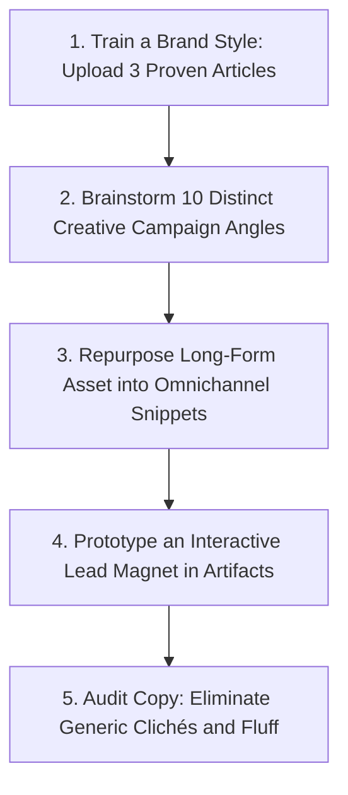

# Onboarding Guide: Content Creators and Marketers

<div class="doc-header-badges">
  <span class="badge badge-surface">Platform: Web · Desktop · Mobile</span>
  <span class="badge badge-level">Level: Level 2 (Intermediate)</span>
  <span class="badge badge-verified">Last Verified: November 2026</span>
</div>

> [!NOTE]
> **Learning Objectives:** Learn how to train custom brand writing styles, turn long-form whitepapers into omnichannel social campaigns, prototype interactive lead-magnets with Artifacts, and banish generic AI corporate clichés from your marketing copy.

---

## Who This Path Is For

This guide is designed for **copywriters, content strategists, digital marketers, social media managers, SEO specialists, and creative directors**.

Modern marketing requires creating high-volume, multi-channel content without sacrificing brand voice, emotional nuance, or intellectual depth. Claude is uniquely suited for marketing professionals because of its exceptional command of tone, nuance, and structural formatting. Rather than generating sterile, recognizable "AI fluff," you can teach Claude to mirror your brand's unique cadence, humor, and style.

---

## Recommended Claude Features & Workflows

| Capability | What It Unlocks for Marketers | Where to Access |
| :--- | :--- | :--- |
| **Custom Writing Styles** | Clones your brand's authentic voice by analyzing uploaded sample articles, blog posts, or style guides. | Composer > "Use style" > "Create & edit styles" |
| **Interactive Artifacts** | Generates live, working React prototypes, interactive marketing ROI calculators, and custom SVG illustrations in a split screen. | Composer (triggers automatically on code/visual requests) |
| **Omnichannel Repurposing**| Ingests a 20-page whitepaper or podcast transcript and extracts LinkedIn posts, Twitter/X threads, and newsletter blurbs. | Composer > Attach document |
| **Web Search with Citations**| Researches current market trends, competitor messaging, and industry statistics with verified inline links. | Composer > Toggle Web Search |

---

## Step-by-Step Beginner Activities ("Your Path, Top Down")



### Step 1: Clone Your Brand Voice with Custom Styles
Do not prompt Claude with vague adjectives like *"make it engaging and witty"*. Instead, navigate to **Use style > Create style**. Paste 2–3 of your company's highest-performing blog posts or newsletters. Claude analyzes your average sentence length, vocabulary, and paragraph pacing, saving it as a persistent style preset.

### Step 2: Use Few-Shot Examples (Golden Samples)
When requesting ad headlines or social copy, always provide 2 "golden examples" of posts that converted well in the past. As taught in [Part B, Module 8: Prompting](../foundations/part-b/module-08-prompting.md), showing a sample teaches Claude faster than explaining.

### Step 3: Prototype Interactive Lead Magnets with Artifacts
Take your content beyond static text. Ask Claude to build an interactive React calculator (e.g., an *"Email Marketing ROI Estimator"*) that your audience can interact with directly in the Artifacts window.

---

## Practical Examples & Copy-Ready Prompts

### Example 1: The Omnichannel Asset Repurposing Engine
Use this prompt when turning a dense webinar transcript, customer case study, or whitepaper into a week's worth of multi-channel social assets.

```xml
<context>
[Attach case_study_fintech_growth.pdf]
We have just published a case study detailing how our client, PayWave, reduced fraudulent transactions by 42% in 90 days using our AI gateway.
</context>

<instructions>
Act as a Principal Brand Strategist. Repurpose this case study into four distinct assets:
1. LinkedIn Thought Leadership Post:
   - Hook focused on a counterintuitive industry insight.
   - 3 skimmable bullet points with concrete metrics.
   - Conversational, authoritative tone without buzzwords. Under 200 words.
2. Twitter / X Thread (3 Tweets):
   - Tweet 1: High-impact hook + metric.
   - Tweet 2: The technical bottleneck PayWave faced.
   - Tweet 3: The key takeaway + link placeholder.
3. Executive Email Newsletter Blurb:
   - 120 words for busy VP-level subscribers with a clear CTA button text.
4. Three Punchy Paid Ad Headlines:
   - Max 30 characters each for Google/LinkedIn ads.
</instructions>
```

#### Expected Result:
Claude delivers distinct, channel-optimized formats that respect platform character ceilings and tone norms, rather than copying and pasting the same generic paragraph across all channels.

---

### Example 2: Interactive Lead-Magnet Calculator (React Artifact)

```xml
<context>
We want to capture leads on our SaaS website for an SEO optimization software tool.
</context>

<instructions>
Build a fully interactive single-file React component in an Artifact:
- Title: "Organic Traffic Value Calculator"
- Inputs: Monthly Website Visitors (slider from 1,000 to 500,000), Average Conversion Rate (slider 0.5% to 5.0%), and Average Customer LTV (number input).
- Output: Displays estimated Monthly Revenue from Organic Traffic and Annualized Pipeline Value.
- Visuals: Use modern Tailwind CSS styling with clean cards, dark text, and subtle shadows.
</instructions>
```

#### Expected Result:
The right-hand **Artifacts** panel slides open, instantly rendering a live, interactive slider-based calculator that recalculates revenue in real time as sliders move.

---

## Common Mistakes & How to Fix Them

> [!WARNING]
> **Common Mistake: The "Fast-Paced World" AI Cliché**
> Without negative constraints, language models default to recognizable filler phrases: *"In today's fast-paced digital landscape...", "It's important to remember...", "A testament to..."*
> **The Fix:** Add a standing negative rule: *"Do not use passive filler phrases or clichés. Begin directly with a bold statement or concrete statistic."*

> [!TIP]
> **Pro Tip: Turn Your Style into a Reusable Skill**
> In accordance with [Part B, Module 10: Skills as Recipe Cards](../foundations/part-b/module-10-skills.md), if you write a newsletter every Tuesday, save your header template, sign-off, and tone rules as a persistent **Weekly Newsletter Skill** so anyone on your team can produce matching issues.

---

## Limitations & Important Considerations

- **Real-Time Social Trends:** Claude's base knowledge has a cutoff date. When writing about breaking viral trends or today's algorithmic changes, enable the **Web Search** toggle.
- **Image Generation:** Claude generates and renders vector graphics (SVG) and Mermaid diagrams natively in Artifacts, but does not output raw photographic JPEG/PNG images.

---

## Hands-On Exercise: 15-Minute Brand Sprint

1. Open [claude.ai](https://claude.ai) and start a new conversation.
2. Click **Use style** in the composer and select **Create & edit styles**.
3. Name your style *"Brand Voice"* and paste two sample blog posts or emails you wrote that reflect your ideal tone.
4. Save the style.
5. Paste the **Omnichannel Repurposing Prompt** above, select your new *"Brand Voice"* style, and compare how closely Claude matches your sentence structure.

---

## Related Foundational Modules

- [Part A, Module 2: What Is an LLM?](../foundations/part-a/module-02-what-is-an-llm.md) — Understanding why creative answers have natural variation.
- [Part B, Module 8: Prompting & Instructions](../foundations/part-b/module-08-prompting.md) — Formatting requests with Situation, Goal, Background, and Format.
- [Part B, Module 10: Skills as Recipe Cards](../foundations/part-b/module-10-skills.md) — Reusing templates for weekly content production.

---

## Related Masterclass Guides

- [04. Writing, Editing & Style Mastery Overview](../04-writing-and-communication/index.md) — In-depth guide to drafting, editing, and voice training.
- [08. Visual & Interactive Artifacts Overview](../08-visual-and-interactive-artifacts/index.md) — Mastering React prototypes, SVGs, and Mermaid diagrams.
- [11. Workplace Playbooks: Marketing & Campaigns](../11-workplace-and-industry-playbooks/index.md) — End-to-end editorial calendars and ad variant workflows.

---

## Official References

- [Anthropic Help Center: Claude Artifacts](https://support.anthropic.com/en/articles/9487310-what-are-artifacts-and-how-do-i-use-them)
- [Anthropic: Custom Styles & Voice Personalization](https://support.anthropic.com/en/articles/10103770-custom-styles)

