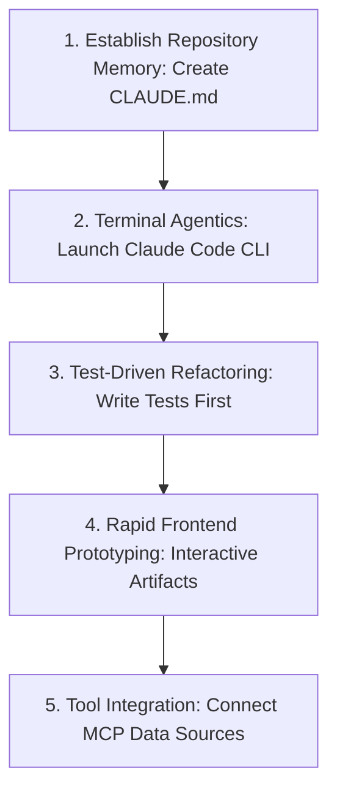

# Onboarding Guide: Developers and Engineers

<div class="doc-header-badges">
  <span class="badge badge-surface">Platform: Web · Desktop · CLI · API</span>
  <span class="badge badge-level">Level: Level 3 (Advanced)</span>
  <span class="badge badge-verified">Last Verified: November 2026</span>
</div>

> [!NOTE]
> **Learning Objectives:** Discover how software engineers, full-stack developers, and DevOps teams leverage Claude across the software development lifecycle—from terminal-native pair programming with Claude Code CLI and repository memory (`CLAUDE.md`), to rapid UI prototyping in Artifacts and tool orchestration via Model Context Protocol (MCP).

---

## Who This Path Is For

This guide is designed for **software engineers, backend developers, frontend designers, DevOps practitioners, QA automation engineers, and technical architects**.

Modern software engineering is no longer limited to copy-pasting snippets into web chat interfaces. Developers today use Claude as an autonomous pair programmer: diagnosing stack traces, authoring comprehensive unit test suites, refactoring legacy codebases, querying live production databases through standardized tool protocols, and executing multi-file edits directly inside the terminal.

---

## Recommended Claude Features & Workflows

| Capability | What It Unlocks for Developers | Where to Access |
| :--- | :--- | :--- |
| **Claude Code CLI** | An agentic command-line tool that operates directly inside your git repo, edits files across directories, executes tests, and fixes build breaks autonomously. | Terminal via `npm install -g @anthropic-ai/claude-code` |
| **Project Memory (`CLAUDE.md`)** | A root repository markdown file that anchors Claude's understanding of your project's architecture, build commands, test patterns, and coding conventions. | Root directory of any repository (`./CLAUDE.md`) |
| **Interactive Artifacts** | Real-time split-screen rendering for React/Tailwind frontend components, interactive API mockups, and Mermaid system architecture diagrams. | Composer (triggers automatically when writing code/diagrams) |
| **Model Context Protocol (MCP)** | Open-standard client-server integration connecting Claude to local databases (PostgreSQL/SQLite), GitHub repositories, terminal tools, and internal APIs. | Claude Desktop (`claude_desktop_config.json`) or Claude Code CLI |
| **Messages API & Extended Thinking** | Programmatic access with multi-turn prompt caching (up to 90% cost reduction), structured JSON outputs (tool use), and extended reasoning tokens for complex algorithmic challenges. | Anthropic Console & SDKs (`@anthropic-ai/sdk`, `anthropic-python`) |

---

## Step-by-Step Developer Activities ("Your Path, Top Down")



### Step 1: Establish Project Memory (`CLAUDE.md`)
Before asking Claude to modify code in any repository, create a `CLAUDE.md` file in the project root. This file serves as persistent contextual memory (see [Part B, Module 11: Tools & The Harness](../foundations/part-b/module-11-tools-and-harness.md)). It specifies build commands, testing frameworks, linting rules, and directory conventions so Claude never guesses how your project compiles.

### Step 2: Work Terminal-Native with Claude Code
For hands-on coding, use Claude Code in your terminal (`claude`). Rather than manually copying files into chat, Claude Code reads your working tree, generates diffs, runs test suites via bash execution, and asks for confirmation before applying changes.

### Step 3: Practice Test-Driven Verification (TDD)
Never ask Claude to "just fix the bug" in isolation. Always instruct Claude to:
1. Write a failing unit test reproducing the exact issue.
2. Apply the minimal code changes necessary to pass the test.
3. Verify that all existing unit tests in the suite continue to pass.

---

## Practical Examples & Copy-Ready Prompts

### Example 1: Bug Isolation & Test-Driven Refactoring
Use this structured prompt when debugging complex asynchronous logic or refactoring legacy methods.

```xml
<context>
We have an asynchronous rate-limiter middleware written in TypeScript using Redis and token bucket algorithms. Under high concurrent burst traffic, tokens occasionally go negative, allowing unauthorized requests through.
Attached: `src/middleware/rateLimiter.ts` and `tests/rateLimiter.test.ts`.
</context>

<instructions>
Act as a Principal Systems Engineer. Follow strict test-driven development:
1. Root Cause Analysis:
   - Identify the exact race condition in the Redis multi/exec transaction sequence.
   - Explain why the current atomic counter check fails under concurrent execution.
2. Reproduction Test:
   - Write a Jest test case that simulates 50 concurrent requests exceeding the token bucket limit and asserts that no more than the exact allowed quota succeeds.
3. Code Fix:
   - Rewrite the rate limiter method using an atomic Lua script executed in Redis to guarantee atomicity.
   - Provide clean, typed TypeScript with zero external dependencies beyond ioredis.
4. Edge Case Review:
   - Detail what happens if the Redis node restarts mid-execution or network timeouts occur.
</instructions>
```

#### Expected Result:
Claude isolates the race condition, writes a failing concurrency test reproducing the negative token count, and provides a production-grade atomic Redis Lua script that passes the test suite.

---

### Example 2: Generating Repository Architecture Memory (`CLAUDE.md`)
Use this prompt to generate a production-ready `CLAUDE.md` specification file for your repository.

```xml
<context>
We are onboarding Claude Code onto a modern Next.js 15 (App Router) + Tailwind CSS + Prisma + PostgreSQL full-stack codebase.
Package manager: pnpm
Test runner: Vitest
Linting: ESLint + Prettier
</context>

<instructions>
Generate a comprehensive, token-efficient `CLAUDE.md` project guide for the repository root:
1. Essential Commands:
   - Exact commands for dev server, linting, type-checking, database migrations, and running individual tests.
2. Architecture & Code Style:
   - Directory structure overview (`/app`, `/components/ui`, `/lib/db`, `/actions`).
   - Server Actions vs Client Components conventions.
   - Error handling patterns (never throw raw errors to clients; use typed result objects).
3. Critical Boundaries:
   - State clearly that database schema migrations require explicit human confirmation.
   - Emphasize running `pnpm type-check` before committing any change.
</instructions>
```

#### Expected Result:
Claude outputs a concise, structured markdown guide ready to be saved as `CLAUDE.md`, immediately upgrading the accuracy of all subsequent agentic coding sessions.

---

## Common Mistakes & How to Fix Them

> [!WARNING]
> **Common Mistake: Pasting Error Messages Without Code Context**
> Submitting only a stack trace (`TypeError: Cannot read properties of undefined (reading 'map')`) forces Claude to hallucinate what your data structure looks like.
> **The Fix:** Provide the function signature, the incoming payload schema, and the stack trace together using XML tags (`<error>`, `<code>`, `<input_data>`).

> [!TIP]
> **Pro Tip: Run Tests Autonomously with the Harness Loop**
> In accordance with [Part B, Module 12: Agents — The Next Frontier](../foundations/part-b/module-12-agents.md), pair Claude with a test runner in your harness. When Claude can see compiler output and test failure reports directly, it can fix its own syntax mistakes and logic errors iteratively without human intervention.

---

## Limitations & Important Considerations

- **Terminal Execution Permissions:** When using Claude Code CLI, Claude requests permission before running bash commands or modifying files. Review commands carefully before approving execution.
- **Context Budget in Large Repositories:** Language models cannot hold million-line codebases in a single prompt. Use targeted tools (ripgrep, file listings, MCP directory search) rather than dumping entire directories into the context window.
- **Secrets & API Keys:** Never paste private `.env` files, production database passwords, or unredacted authorization headers into prompts. Use local environment variables and secret managers.

---

## Hands-On Exercise: 15-Minute Developer Sprint

1. Open your terminal and create a scratch directory:
   ```bash
   mkdir claude-dev-sprint && cd claude-dev-sprint
   git init
   ```
2. Create a minimal `CLAUDE.md` specifying your favorite language and testing framework.
3. Open [claude.ai](https://claude.ai) or launch Claude Code in your terminal.
4. Paste the **Repository Memory Prompt** above, customized with your project's stack.
5. Save the generated output to `CLAUDE.md` and notice how accurately subsequent coding tasks adhere to your specific conventions.

---

## Related Foundational Modules

- [Part A, Module 3: How LLMs Work](../foundations/part-a/module-03-how-llms-work.md) — Understanding token processing and probabilistic generation.
- [Part B, Module 7: Context & The Desk](../foundations/part-b/module-07-context.md) — Managing token budgets and context cache reuse.
- [Part B, Module 11: Tools & The Harness](../foundations/part-b/module-11-tools-and-harness.md) — Understanding function calling, MCP, and developer execution harnesses.
- [Part B, Module 12: Agents — The Next Frontier](../foundations/part-b/module-12-agents.md) — Agentic loops: Observe, Orient, Decide, Act.
- [Part B, Module 13: Permissions, Limits & Staying Safe](../foundations/part-b/module-13-permissions-and-safety.md) — Sandboxing terminal execution and preventing prompt injection.

---

## Related Masterclass Guides

- [12. Claude Code & Terminal Workflows Overview](../12-claude-code-and-developers/index.md) — Deep dive into the Claude Code CLI, agentic loop, and git automation.
- [13. Model Context Protocol (MCP) Overview](../13-model-context-protocol-mcp/index.md) — Authoring custom MCP servers and connecting Claude Desktop to databases.
- [14. Building with Claude API & SDKs Overview](../14-building-with-claude-api/index.md) — Integrating the Messages API, prompt caching, and structured tool use.

---

## Official References

- [Anthropic Claude Code Overview](https://docs.anthropic.com/en/docs/agents-and-tools/claude-code/overview)
- [Anthropic Model Context Protocol (MCP) Quickstart](https://modelcontextprotocol.io)
- [Anthropic API Documentation](https://docs.anthropic.com/en/api/getting-started)
