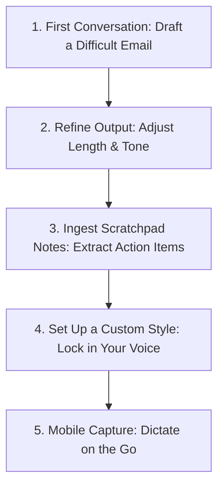

# Onboarding Guide: General Productivity Users

<div class="doc-header-badges">
  <span class="badge badge-surface">Platform: Web · Desktop · iOS · Android</span>
  <span class="badge badge-level">Level: Level 1 (Beginner)</span>
  <span class="badge badge-verified">Last Verified: November 2026</span>
</div>

> [!NOTE]
> **Learning Objectives:** Learn how to use Claude to accelerate everyday writing, organize thoughts, convert messy meeting notes into polished action items, and establish your authentic writing tone in minutes.

---

## What is Claude for Everyday Productivity?

Anthropic Claude is an AI thinking partner and writing assistant accessible via web browser ([claude.ai](https://claude.ai)), desktop application (macOS and Windows), and mobile apps (iOS and Android). Unlike rigid rule-based tools, Claude excels at natural dialogue, nuanced language comprehension, and handling lengthy, unstructured text.

For everyday users, Claude acts as a tireless collaborator that helps you draft communications, summarize lengthy discussions, prioritize to-do lists, and brainstorm solutions to daily work friction.

---

## Why and When Should You Use It?

### Best Suited For:
- **Email drafting and tone adjustment:** Transforming blunt or rushed bullet points into polite, professional workplace emails.
- **Meeting synthesis:** Ingesting raw transcripts or scratchpad notes and extracting clear decisions, owners, and deadlines.
- **Brainstorming:** Overcoming blank-page syndrome for presentations, speech outlines, or gift ideas.
- **Mobile voice capture:** Speaking stream-of-consciousness ideas into your phone and having Claude organize them into clean outlines.

### Avoid When:
- Performing raw, high-volume spreadsheet number crunching without reviewing formulas (use the built-in [Analysis Tool](../07-data-analysis/index.md) instead).
- Requiring real-time calendar bookings or sending emails automatically on your behalf (Claude assists with drafting; you review and send).

---

## Prerequisites & Availability

- **Supported Platforms:** Web ([claude.ai](https://claude.ai)), Claude Desktop (macOS 12+, Windows 10+), Claude iOS App, Claude Android App.
- **Required Plan:** Free plan covers core chat and everyday drafting. The **Pro plan ($20/month)** unlocks custom writing styles, unlimited Projects, and 5× higher message quotas.
- **Prerequisites:** A verified email address or Google account.

---

## Where to Find and Access It

1. Visit **[claude.ai](https://claude.ai)** in your browser or launch the Claude Desktop app.
2. Sign in to your account.
3. You will immediately see the central message composer: *"How can Claude help you today?"*
4. On mobile devices, tap the **Microphone** icon inside the composer to dictate your prompt hands-free.

---

## Step-by-Step Onboarding Path ("Your Path, Top Down")



### Step 1: Start Your First Conversation
Avoid typing single-word prompts like *"write email"*. Give Claude:
1. **Role / Scenario:** Who you are writing to.
2. **Key details:** Points that must be included.
3. **Desired tone:** Professional, direct, polite, or casual.

### Step 2: Refine in Multi-Turn Dialogue
If the first draft is too long or formal, do not start over in a new window. Reply directly in the same chat:
> *"Make this 40% shorter and soften the closing sentence so it feels warmer."*

### Step 3: Turn Messy Notes into Clear Action Items
Paste rough bullet points from your phone or notepad and instruct Claude to categorize them into immediate tasks, dependencies, and follow-ups.

---

## Practical Examples & Copy-Ready Prompts

### Example 1: The "Blunt Notes to Diplomatic Email" Prompt
Use this prompt when you have quick thoughts that need to be delivered diplomatically to clients or management.

```xml
<context>
I need to write an email to our vendor, Apex Logistics. Their software update was delayed by 3 business days, which impacted our shipping schedule.
</context>

<instructions>
Draft a professional, firm, but collaborative email.
- Acknowledge that unexpected technical issues happen.
- State clearly that our warehouse had to pause packing operations for 48 hours.
- Request an updated delivery timetable by 4:00 PM today.
- Keep the length under 150 words.
</instructions>
```

#### Expected Result:
Claude produces a concise, three-paragraph email that addresses the issue without passive-aggressive phrasing, including clear time boundaries and polite sign-offs.

---

### Example 2: Meeting Minutes to Executive Summary

```xml
<context>
Here are raw notes taken during our weekly marketing sync:
- Sarah: paid ads CPA increased 15% on Meta. Creative fatigue suspected.
- Dave: organic blog traffic up 22% month-over-month. Top article is AI tools guide.
- Elena: budget approval needed for Q2 webinar platform ($1,200). Need sign-off by Friday.
- Sarah to test 4 new video hooks by Wednesday.
</context>

<instructions>
Please organize these notes into:
1. One-sentence Executive Summary for leadership.
2. Key Performance Metrics (in a bulleted list).
3. Action Items table with columns: Action, Owner, Deadline.
</instructions>
```

#### Expected Result:
A cleanly structured Markdown memo featuring an executive-ready summary sentence, highlighted metrics, and an easy-to-read table with assigned owners and due dates.

---

## Common Mistakes & How to Fix Them

> [!WARNING]
> **Common Mistake: The "Vague Prompt Trap"**
> Asking *"Write a memo about customer feedback"* results in generic filler text with platitudes.
> **The Fix:** Provide 3 specific examples of customer feedback and state the goal of the memo (e.g., *"Propose 2 product fixes based on these 3 support complaints"*).

> [!TIP]
> **Pro Tip: Use the "Use Style" Selector**
> In the message composer, click the **Use style** dropdown. Select **Concise** if you want short, punchy responses with zero preamble, or **Formal** for executive communications.

---

## Limitations & Important Considerations

- **Real-Time World State:** Claude's base knowledge reflects its training cutoff. For events or stock prices that occurred today, enable the **Web Search** toggle in the composer.
- **Privacy Awareness:** Never paste sensitive personal identifiable information (PII), unredacted social security numbers, or confidential passwords into any conversation. Review [02. Getting Started](../02-getting-started/index.md) for details.

---

## Hands-On Exercise: 10-Minute Quickstart

1. Open [claude.ai](https://claude.ai) and sign in.
2. Copy the **Meeting Minutes Prompt** above and paste it into the composer.
3. Ask Claude to modify the output: *"Rewrite the action items into an email draft addressed to Sarah, Dave, and Elena."*
4. Notice how Claude preserves the assigned owners and deadlines from the prior turn.

---

## Related Guides & Next Steps

- [02. Getting Started Overview](../02-getting-started/index.md) — Learn about Free vs. Pro usage quotas and setup.
- [04. Writing & Communication Overview](../04-writing-and-communication/index.md) — Advanced email, memo, and drafting patterns.
- [Foundational Training: Part A](../foundations/part-a/index.md) — Deep dive into AI basics and how LLMs generate text.

---

## Official References

- [Anthropic Help Center: Getting Started](https://support.anthropic.com/en/collections/4078534-getting-started)
- [Anthropic: Claude User Guide](https://docs.anthropic.com/en/docs/welcome)

