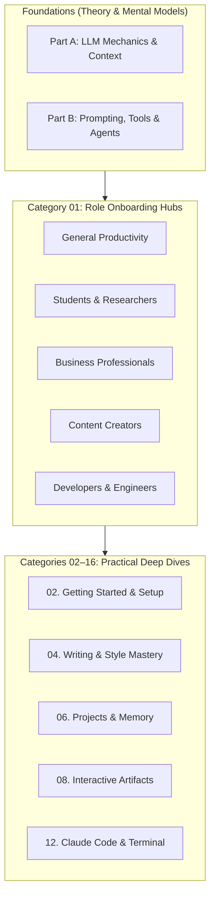

# 01. Start Here: Role-Based Onboarding Hubs

  Platform: Web · Desktop · Mobile · CLI · API
  Level: All Levels (L1 to L4)
  Last Verified: November 2026

> [!NOTE]
> **Category Purpose:** Welcome to **CLAUDE MASTERCLASS**. Rather than forcing you through a generic, one-size-fits-all manual, this category provides specialized, role-tailored onboarding hubs designed to get you productive with Anthropic Claude AI immediately in your specific discipline.

---

## Choose Your Role-Based Learning Path

Select the onboarding guide that best matches your daily work and objectives:

-   :material-feather: **[General Productivity & Everyday Writing](general-productivity.md)**

    ---

    Designed for anyone seeking to accelerate daily tasks. Learn how to draft emails, summarize documents, brainstorm ideas, configure custom writing styles, and organize personal knowledge.

    [:octicons-arrow-right-24: Open General Productivity Guide](general-productivity.md)

-   :material-school: **[Students, Academics & Researchers](students-researchers.md)**

    ---

    Designed for undergraduates, graduate scholars, researchers, and educators. Learn how to use Claude as an active Socratic study partner, analyze dense PDF literature, synthesize research, and maintain academic integrity.

    [:octicons-arrow-right-24: Open Students & Researchers Guide](students-researchers.md)

-   :material-briefcase: **[Business Professionals & Operations](business-professionals.md)**

    ---

    Designed for project managers, business analysts, executives, and team leads. Learn how to configure persistent Claude Projects, analyze spreadsheets, extract trends, and draft high-stakes executive memos.

    [:octicons-arrow-right-24: Open Business Professionals Guide](business-professionals.md)

-   :material-bullhorn: **[Content Creators & Marketers](content-creators-and-marketers.md)**

    ---

    Designed for copywriters, social media managers, SEO specialists, and creative directors. Learn how to train custom brand styles, turn long-form whitepapers into omnichannel campaigns, and prototype interactive lead-magnets in Artifacts.

    [:octicons-arrow-right-24: Open Content Creators Guide](content-creators-and-marketers.md)

-   :material-code-braces: **[Developers & Software Engineers](developers-and-engineers.md)**

    ---

    Designed for software engineers, DevOps, and technical architects. Learn how to pair program with Claude Code CLI in your terminal, establish repository memory with `CLAUDE.md`, practice test-driven refactoring, and connect external tools via MCP.

    [:octicons-arrow-right-24: Open Developers Guide](developers-and-engineers.md)

---

## Role Paths at a Glance

| Role | Primary Interface | Signature Features | First 15-Minute Milestone |
| :--- | :--- | :--- | :--- |
| **General Productivity** | Web / Mobile App | Custom Styles, Voice Dictation, Web Search | Configure a custom voice style and rewrite an email thread. |
| **Students & Researchers** | Web / Desktop App | Multi-Doc Upload, PDF Analysis, Socratic Mode | Synthesize 2 research papers with verifiable citations. |
| **Business Professionals** | Web (Projects Workspace) | Team Projects, Data Analysis, Shared Memory | Create a Project with custom instructions and analyze a CSV report. |
| **Content Creators** | Web (Artifacts Split-View) | Custom Brand Styles, Omnichannel Repurposing, React Artifacts | Clone your company voice and build an interactive lead-magnet calculator. |
| **Developers & Engineers** | Terminal (Claude Code) / API | `CLAUDE.md`, Test-Driven Autonomy, MCP Servers | Initialize a repository memory file and run an automated bugfix loop. |

---

## How This Curriculum Connects to Fundamentals

Every practical technique taught in these onboarding hubs builds upon foundational principles from our Company AI Training curriculum:

- **Need the basics first?** Start with [Part A: Core Fundamentals](../foundations/part-a/index.md) to understand tokens, context windows, and model frontiers.
- **Want deeper prompting patterns?** Explore [Part B: Advanced Concepts](../foundations/part-b/index.md) for context engineering, skills, and agentic workflows.
- **Ready to set up your account?** Continue directly to [02. Getting Started & Setup](../02-getting-started/index.md).
