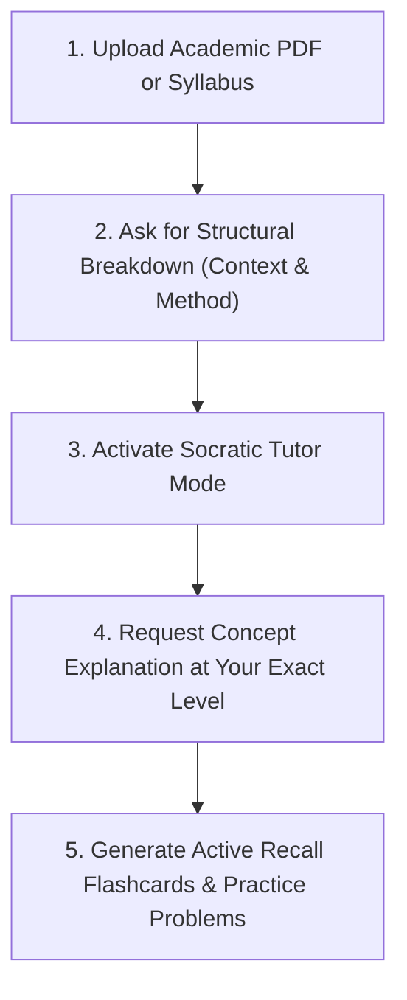

# Onboarding Guide: Students and Researchers

<div class="doc-header-badges">
  <span class="badge badge-surface">Platform: Web · Desktop</span>
  <span class="badge badge-level">Level: Level 1 (Beginner) to Level 2 (Intermediate)</span>
  <span class="badge badge-verified">Last Verified: November 2026</span>
</div>

> [!NOTE]
> **Learning Objectives:** Discover how to transform Claude into an active study partner, understand complex academic papers, break down difficult formulas using Socratic dialogue, and ethically verify research claims.

---

## What is Claude for Students and Academics?

For students, educators, and academic researchers, Claude serves as a patient intellectual sparring partner rather than an essay ghostwriter. Because Claude handles large context windows (up to 200,000 tokens) and natively supports multimodal PDF ingestion, you can upload entire academic papers, lecture slide decks, and lab datasets directly into your conversation.

Rather than providing passive answers that hinder learning, Claude can be instructed to teach using the **Socratic method**—posing clarifying questions, testing your comprehension, and guiding you toward the solution.

---

## Why and When Should You Use It?

### Best Suited For:
- **Deconstructing dense literature:** Summarizing methodology sections, theoretical frameworks, and research limitations in multi-page academic PDFs.
- **Socratic study partner:** Asking Claude to quiz you on key mechanisms before an exam.
- **Translating jargon across expertise levels:** Requesting explanations of graduate-level physics or economics in plain, relatable language.
- **Literature synthesis:** Comparing two opposing research papers to identify methodological differences.

### Avoid When:
- Generating essays or coursework for submission without attribution (violates academic integrity policies).
- Trusting bibliographic citations blindly without checking real library databases (always verify sources using [05. Learning & Research](../05-learning-and-research/index.md)).

---

## Prerequisites & Availability

- **Supported Platforms:** Web ([claude.ai](https://claude.ai)), Desktop apps, iPad/tablet web browsers.
- **Supported File Types:** PDF, Word (.docx), plain text (.txt), Markdown (.md), CSV, and images (PNG, JPEG, WebP). Max 30MB per file.
- **Required Plan:** Free plan covers core paper reading and tutoring. Pro plan ($20/month) is recommended for intensive research sessions requiring higher message limits and access to **Claude 3.7 Sonnet** and **Claude 3 Opus**.

---

## Where to Find and Access It

1. Navigate to **[claude.ai](https://claude.ai)**.
2. In the chat composer, click the **Paperclip** icon (or drag and drop your PDF or notes directly into the window).
3. Type your instructions alongside the uploaded document.

---

## Step-by-Step Onboarding Path



### Step 1: Upload and Scope the Material
Upload your textbook chapter or research PDF. Instruct Claude to summarize the core problem statement, hypothesis, and methodology first, before diving into conclusions.

### Step 2: Request Active Tutoring (Socratic Mode)
Explicitly prompt Claude: *"Do not give me the answer directly. Ask me questions one at a time to test my understanding."*

### Step 3: Verify Claims and Quotes
Ask Claude to quote the exact page and sentence in the uploaded PDF where a specific claim is made.

---

## Practical Examples & Copy-Ready Prompts

### Example 1: The Socratic Tutor Prompt
Use this prompt when studying difficult STEM or humanities topics to prepare for an exam.

```xml
<context>
I am preparing for an undergraduate exam in Molecular Biology. The topic is DNA Replication and the role of topoisomerases and helicase.
</context>

<instructions>
Act as a supportive, rigorous university professor.
- Do NOT provide an essay or lecture explaining DNA replication.
- Instead, ask me one targeted question at a time to check my foundational understanding.
- Wait for my answer before providing feedback.
- If my answer is incomplete, give a subtle hint and ask a follow-up question.
- Start with your first question now.
</instructions>
```

#### Expected Result:
Claude initiates dialogue with a single question (e.g., *"To start, what physical problem arises in the DNA double helix when DNA helicase begins unwinding the strands, and what enzyme resolves it?"*) and waits for your input.

---

### Example 2: Ingesting and Deconstructing a Dense Research Paper

```xml
<context>
I have uploaded an academic paper on transformer attention mechanisms.
</context>

<instructions>
Analyze the uploaded PDF and provide:
1. Research Question: What exact problem is this paper addressing?
2. Key Innovation: What did the authors propose that was distinct from prior literature?
3. Methodology Overview: What datasets and benchmark metrics were used?
4. Limitations & Weaknesses: What did the authors acknowledge as limitations?
5. Plain-Language Analogy: Explain the core mechanism using an everyday analogy.
</instructions>
```

#### Expected Result:
Claude returns a structured, non-intimidating breakdown that allows you to determine whether the paper is relevant to your literature review in under 3 minutes.

---

## Common Mistakes & How to Fix Them

> [!WARNING]
> **Common Mistake: Passive Reading**
> Asking *"Summarize this 40-page paper"* produces a high-level overview that leaves no lasting memory.
> **The Fix:** Ask targeted questions: *"What were the control variables in Table 2?"* or *"Challenge the author's assumption on page 14."*

> [!TIP]
> **Pro Tip: Multi-Level Explanation Prompt**
> When stuck on an abstract theoretical concept, prompt: *"Explain this concept in three tiers: 1) To a 12-year-old using a sports analogy, 2) To a college freshman, 3) With full technical rigor."*

---

## Academic Integrity & Responsible Usage

1. **Authorship & Plagiarism:** Use Claude to brainstorm outlines, clarify grammar, and organize notes. Never submit AI-generated text as your own original work.
2. **Citation Auditing:** Large language models can occasionally hallucinate journal volume numbers or DOIs. Always verify citations against PubMed, Google Scholar, or your university library catalog.

---

## Hands-On Exercise: Active Tutoring Session

1. Open a new chat on [claude.ai](https://claude.ai).
2. Paste the **Socratic Tutor Prompt** above, substituting a subject you find challenging (e.g., *Macroeconomics: Fiscal Policy vs. Monetary Policy*).
3. Answer Claude's first question in your own words.
4. Intentionally make a slight mistake in your answer to see how Claude identifies the conceptual gap and guides you back on track.

---

## Related Guides & Next Steps

- [05. Learning & Research Overview](../05-learning-and-research/index.md) — Socratic inquiry and research workflows.
- [06. Documents & Files Overview](../06-documents-and-files/index.md) — Parsing complex tables, papers, and formulas.
- [Foundational Training: Part A](../foundations/part-a/index.md) — Understanding how language models process information.

---

## Official References

- [Anthropic Help Center: Uploading Files and Documents](https://support.anthropic.com/en/articles/8241126-how-do-i-upload-files-to-claude)
- [Anthropic: Educational Prompts & Best Practices](https://docs.anthropic.com/en/prompt-library/library)

