# Foundational AI Training
## Company AI Curriculum: From Core Fundamentals to Advanced Systems

  Curriculum: Company AI Training
  Level: Absolute Beginner to Practitioner
  Attribution: Tactive AI Team

> [!NOTE]
> **Track Overview:** Welcome to the company's internal foundational AI training series. This foundational curriculum is organized into two sequential parts designed to take you from initial curiosity to practical mastery of AI assistants in your daily work.

---

## The Two Foundational Tracks

```mermaid
flowchart LR
    subgraph PartA["Part A: AI Fundamentals"]
        direction TB
        A1["Module 1: What Is AI?"]
        A2["Module 2: What Is an LLM?"]
        A3["Module 3: How LLMs Work"]
        A4["Module 4: Strengths, Limits & Trust"]
        A5["Module 5: Meet Claude"]
    end

    subgraph PartB["Part B: AI Concepts for Working with Systems"]
        direction TB
        B1["Module 6: Types of Models"]
        B2["Module 7: Context"]
        B3["Module 8: Prompting & Instructions"]
        B4["Module 9: Memory"]
        B5["Module 10: Skills"]
        B6["Module 11: Tools & The Harness"]
        B7["Module 12: Agents"]
        B8["Module 13: Permissions & Safety"]
    end

    subgraph CoreCurriculum["Masterclass Application"]
        C1["Practical Category Guides<br/>(Categories 01 to 16)"]
    end

    PartA --> PartB --> CoreCurriculum
```

---

### Track Summary

  

    
🌱

    <h3>Part A: AI Fundamentals</h3>
    
A beginner's guide to understanding what AI is, how Large Language Models work in simple terms, what they do well, where they fail, and how to complete your first real work task.

    <a href="part-a/" class="role-link">Start Part A: Fundamentals →</a>
  

  

    
⚙️

    <h3>Part B: AI Concepts for Working with Systems</h3>
    
The eight core architectural building blocks: model tiers, context, prompting, persistent memory, reusable skills, tools and the harness, autonomous agents, and permission safety.

    <a href="part-b/" class="role-link">Start Part B: Concepts →</a>
  

---

## How This Training Connects to AI MASTERCLASS

These two foundational parts establish the mental models, vocabulary, and safety rules required for working productively with modern AI. Once you complete Parts A and B, you can dive directly into the deep, hands-on practical guides across the **16 core categories**:

- **After Part A:** Explore [Category 01: Start Here](../01-start-here/index.md), [Category 02: Getting Started](../02-getting-started/index.md), and [Category 04: Writing & Communication](../04-writing-and-communication/index.md).
- **After Part B:** Explore [Category 03: Models & Selection](../03-models-and-selection/index.md), [Category 09: Projects & Knowledge Bases](../09-projects-and-knowledge-bases/index.md), [Category 10: Prompt Engineering](../10-prompt-engineering/index.md), and [Category 12: Claude Code & Developers](../12-claude-code-and-developers/index.md).

---

## Attribution & Internal Training Context

This foundational curriculum is authored by the **Tactive AI Team** as part of the company's internal workforce enablement initiative. It is provided here in full to ensure every team member has a consistent, beginner-friendly foundation before advancing to specialized workflows.
