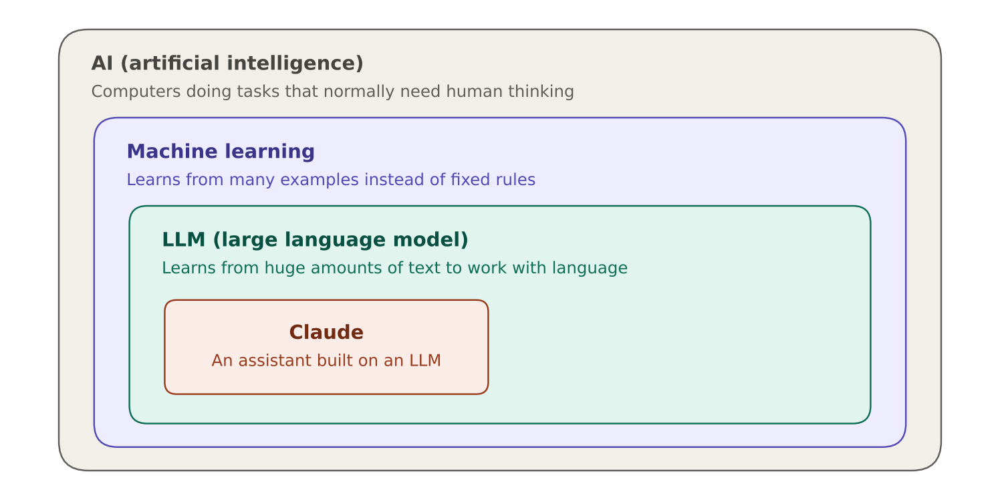
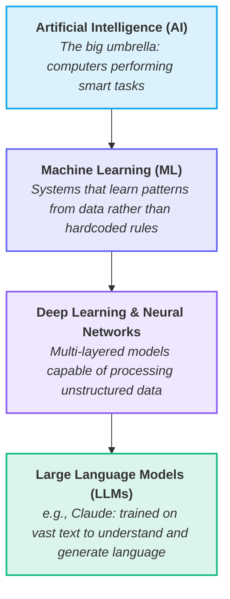

# Module 1: What Is AI?

  Part A: AI Fundamentals
  Module 1 of 5
  Attribution: Tactive AI Team

  

    

      

        

          <svg viewBox="0 0 24 24" width="44" height="44" fill="none" stroke="currentColor" stroke-width="1.8" stroke-linecap="round" stroke-linejoin="round" aria-hidden="true">
            <polygon points="5 3 19 12 5 21 5 3"></polygon>
          </svg>
        

        

          Module Video
          <h3 class="video-title">Module 1: What Is AI?</h3>
          
Video will be available soon

          
Local MP4 upload pending in <code>docs/assets/videos/module-01.mp4</code>

        

      

    

  

**AI (Artificial Intelligence)** means computer programs that can do tasks that normally need human thinking, such as understanding language, spotting patterns, or making suggestions.

You already use AI every day without noticing:

- Your email filters spam.
- Your phone suggests the next word as you type.
- Streaming apps recommend what to watch.
- Maps estimate your travel time.

The AI in this course is different from those. Those tools do one narrow job. The AI we'll learn is a **general-purpose assistant**: you talk to it in normal language, and it can help with writing, summarizing, explaining, planning, analyzing, and much more.

---

## How the Terms Fit Together

| Term | Plain Meaning |
| :--- | :--- |
| **[AI](glossary.md#ai-artificial-intelligence)** | The big umbrella: computers doing "smart" tasks |
| **[Machine learning](glossary.md#machine-learning)** | A way of building AI where the computer learns from many examples instead of being given step-by-step rules |
| **[LLM (Large Language Model)](module-02-what-is-an-llm.md)** | A type of machine learning built to understand and write human language. [Claude](module-05-meet-claude.md) is one |

*Figure 1: Each term sits inside the one before it*

??? info "Traditional Rules vs. Machine Learning"
    === "Traditional Software (Rules-Based)"
        **Inputs + Explicit Rules = Output**
        - Programmers write explicit `if/else` logic for every condition.
        - Reliable for arithmetic, database queries, and rigid workflows.
        - Struggles with nuanced human language, ambiguity, and complex pattern matching.
    === "Machine Learning (Example-Based)"
        **Inputs + Observed Examples = Learned Rules**
        - The model analyzes millions of sample texts to identify statistical relationships.
        - Excels at translation, summarization, nuance, and conceptual reasoning.
        - Operates probabilistically rather than deterministically.

---

## Why Is This Happening Now?

Three things came together:

1. **Huge amounts of text** available to learn from.
2. **Much more powerful computers** capable of processing that text.
3. **Better ways of designing these systems** (advances in neural network architectures).

---

## A Useful Way to Think About Claude

> [!NOTE]
> **The New Colleague Analogy:**
> Imagine a new colleague who has read an enormous amount, works instantly, and is happy to help with almost anything. But they know nothing about your company, your customers, or your project until you tell them, and sometimes they make mistakes. Good results come from explaining things clearly and checking their work.

---

## Common Myths

- **"It thinks like a human."** It doesn't. It works very differently, even if the replies feel natural.
- **"It's like Google."** Google finds existing pages. Claude writes a new answer each time.
- **"It's always right."** It can be wrong, and still sound confident.
- **"It learns from me instantly."** It doesn't change itself during your chat. It only uses what's in the conversation.

---

## Try It

> [!TIP]
> **Hands-On Exercise:** Think of three places in your workday where you spend time on writing, reading, or organizing information. Note them down. We'll come back to them in Module 5.

---

  <a href="../" class="md-button">← Part A Overview</a>
  <a href="../module-02-what-is-an-llm/" class="md-button md-button--primary">Next: Module 2 — What Is an LLM? →</a>

