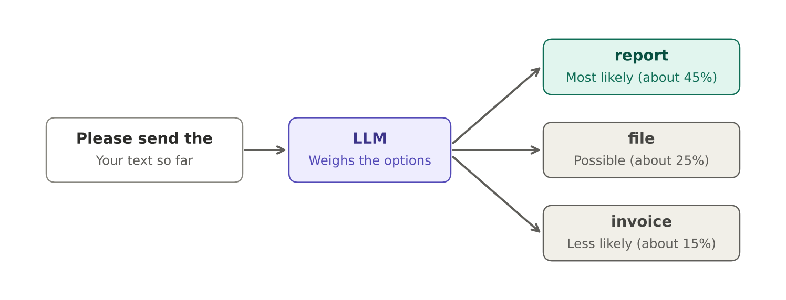

# Module 2: What Is an LLM?

  Part A: AI Fundamentals
  Module 2 of 5
  Attribution: Tactive AI Team

  

    

      

        

          <svg viewBox="0 0 24 24" width="44" height="44" fill="none" stroke="currentColor" stroke-width="1.8" stroke-linecap="round" stroke-linejoin="round" aria-hidden="true">
            <polygon points="5 3 19 12 5 21 5 3"></polygon>
          </svg>
        

        

          Module Video
          <h3 class="video-title">Module 2: What Is an LLM?</h3>
          
Video will be available soon

          
Local MP4 upload pending in <code>docs/assets/videos/module-02.mp4</code>

        

      

    

  

---

## What Is an LLM?

An **LLM (Large Language Model)** is a program that was trained on a huge amount of text (books, articles, websites, and more) so that it learned how language works and how ideas connect.

The core idea is simple: **given some text, an LLM predicts what text should come next.** Do this one small piece at a time, very well, and you get full answers, emails, summaries, and explanations.

Think of the way your phone suggests the next word, but vastly more powerful. It has absorbed so many patterns that it can follow instructions, answer questions, and write in different styles.

*Figure 2: The LLM weighs several likely next words and picks one*

*(The percentages in Figure 2 are examples only, to show the concept.)*

???+ example "Interactive Demonstration: How Next-Token Prediction Works"
    === "Prompt: 'The cat sat on the...'"
        | Candidate Token | Likelihood | Why It's Considered |
        | :--- | :---: | :--- |
        | **`mat`** | 🟩 72% | Most common collocated idiom in training text |
        | **`rug`** | 🟨 15% | Semantically synonymous, plausible furniture surface |
        | **`floor`** | 🟧 8% | Natural fallback physical surface |
        | **`windowsill`** | 🟦 4% | Descriptive, creative context |
        | **`moon`** | ⬜ 1% | Poetic, fictional context |

        > **Why this matters:** The model evaluates this probability distribution token-by-token. Even with identical prompts, slight variations in sampling can produce equally valid, natural phrasings.
    === "Prompt: '2 + 2 = '"
        | Candidate Token | Likelihood | Why It's Considered |
        | :--- | :---: | :--- |
        | **`4`** | 🟩 99.8% | Overwhelming statistical regularity across mathematical literature |
        | **` four`** | 🟨 0.1% | Word-form alternative |
        | *others* | ⬜ < 0.1% | Highly improbable |

        > **Notice the difference:** Factual and mathematical constraints produce near-certain distributions, whereas open creative sentences offer wide distributions.

---

## Tokens

An LLM doesn't read whole words the way we do. It breaks text into small pieces called **[tokens](glossary.md#token)** (a token can be a word, part of a word, or a punctuation mark).

Tokens matter because they set:
1. **How much text the AI can handle at once** (its [context window](../part-b/module-07-context.md#the-desk-has-a-size-limit-the-context-window)).
2. **How usage and costs are measured** (in both API calls and usage limits).

---

## Why Answers Can Differ Each Time

Regular software gives the exact same result every time you perform the same action. An LLM chooses among likely options, as Figure 2 shows.

Asking the same question twice can give two different, equally reasonable answers. This is normal. It is why you should always read and judge the output, not treat it as an unchangeable final product.

---

## Try It

> [!TIP]
> **Hands-On Exercise:** Ask Claude the same question three times, for example:
> *"Give me a short explanation of how to run a good team meeting."*
> 
> Compare the three answers.
> - What stayed the same?
> - What changed?
> - Which phrasing did you prefer, and why?

---

  <a href="../module-01-what-is-ai/" class="md-button">← Module 1: What Is AI?</a>
  <a href="../module-03-how-llms-work/" class="md-button md-button--primary">Next: Module 3 — How Does an LLM Work? →</a>

