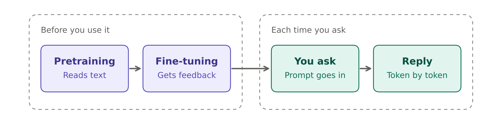
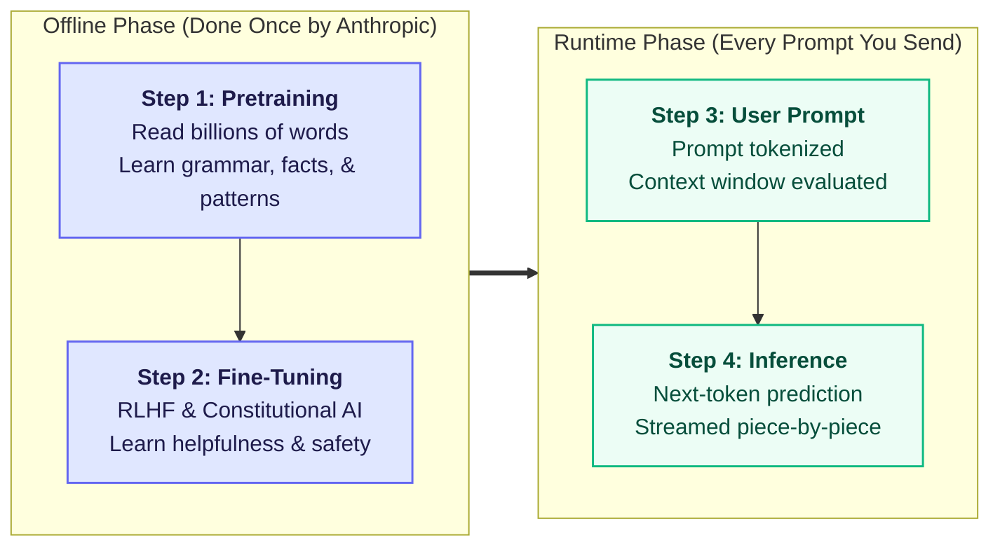

# Module 3: How Does an LLM Work?

  Part A: AI Fundamentals
  Module 3 of 5
  Attribution: Tactive AI Team

  

    

      

        

          <svg viewBox="0 0 24 24" width="44" height="44" fill="none" stroke="currentColor" stroke-width="1.8" stroke-linecap="round" stroke-linejoin="round" aria-hidden="true">
            <polygon points="5 3 19 12 5 21 5 3"></polygon>
          </svg>
        

        

          Module Video
          <h3 class="video-title">Module 3: How Does an LLM Work?</h3>
          
Video will be available soon

          
Local MP4 upload pending in <code>docs/assets/videos/module-03.mp4</code>

        

      

    

  

Here is the simple picture of how an LLM works in four steps. The first two happen once, before you ever use Claude. The last two happen every time you send a message.

*Figure 3: From training to your reply*

---

## The Four Steps

### Step 1: Learning from text ([Pretraining](glossary.md#training))
The model reads a vast amount of text and learns patterns: grammar, facts, writing styles, and how people explain things. This is where most of its general knowledge comes from.

### Step 2: Learning to be helpful ([Fine-tuning](glossary.md#fine-tuning) and feedback)
A model that only predicts text isn't yet a good assistant. It is further trained—including with feedback from people (such as Reinforcement Learning from Human Feedback and Constitutional AI)—so that it follows instructions, stays polite, avoids harmful answers, and gives useful replies.

### Step 3: You ask a question
Your message is turned into [tokens](module-02-what-is-an-llm.md#tokens), and the model uses everything in the conversation so far to work out a response.

### Step 4: It writes the reply piece by piece
It predicts one token at a time until the answer is complete. That is why you often see the reply appear gradually across your screen.

---

## Three Important Things to Know

### 1. It has a [knowledge cutoff](glossary.md#knowledge-cutoff)
The model learned from text up to a certain date. It will not know about events or data after that cutoff date unless it is given a way to search the live web or you provide the information directly in your prompt.

### 2. It doesn't look things up by default
It answers from what it learned during training, not from an active database of verified live facts.

> [!NOTE]
> **Editorial Verification Note (Current Claude Features):**
> On modern Claude.ai interfaces, Claude now features an integrated **Web Search tool** that can be toggled on to look up real-time information and supply inline citations. When Web Search is toggled off, Claude relies strictly on its trained weights.

### 3. [Hallucination](glossary.md#hallucination)
Because an LLM generates likely-sounding text, it can sometimes produce details that are false—such as an incorrect figure, a made-up source, or a wrong date—and present them with high confidence. This is called a **hallucination**. It is the primary reason we always check important information (see the [Trust Rule in Module 4](module-04-strengths-limits-trust.md#the-trust-rule-check-in-proportion-to-the-stakes)).

---

## Try It

> [!TIP]
> **Hands-On Exercise:** Ask Claude about something very specific to your company (such as an internal policy or project code name) or something that happened in the news very recently.
> 
> Notice what it says:
> - Does it admit it doesn't know?
> - Does it ask you for details, or does it guess?
> - Discuss why with your team.

---

  <a href="../module-02-what-is-an-llm/" class="md-button">← Module 2: What Is an LLM?</a>
  <a href="../module-04-strengths-limits-trust/" class="md-button md-button--primary">Next: Module 4 — Strengths, Limits, and Trust →</a>

