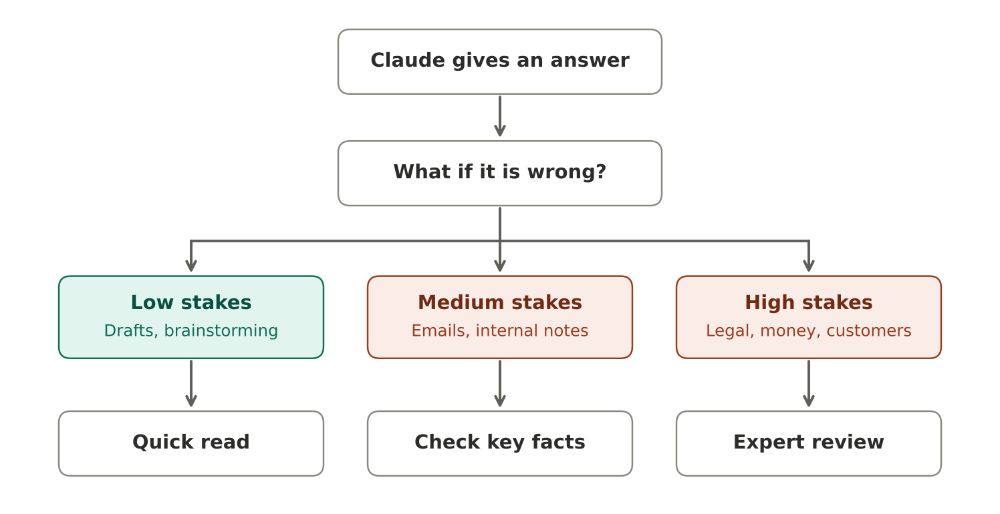

# Module 4: Strengths, Limits, and Trust

  Part A: AI Fundamentals
  Module 4 of 5
  Attribution: Tactive AI Team

  

    

      

        

          <svg viewBox="0 0 24 24" width="44" height="44" fill="none" stroke="currentColor" stroke-width="1.8" stroke-linecap="round" stroke-linejoin="round" aria-hidden="true">
            <polygon points="5 3 19 12 5 21 5 3"></polygon>
          </svg>
        

        

          Module Video
          <h3 class="video-title">Module 4: Strengths, Limits, and Trust</h3>
          
Video will be available soon

          
Local MP4 upload pending in <code>docs/assets/videos/module-04.mp4</code>

        

      

    

  

Understanding where AI excels and where it stumbles is the foundation of using it safely and productively.

---

## What AI Is Good At

- Drafting emails, reports, proposals, and team messages.
- Rewriting text to be clearer, shorter, more diplomatic, or more formal.
- Summarizing long documents, meeting transcripts, and articles.
- Explaining difficult technical topics in simple everyday words.
- Brainstorming creative ideas, options, and project outlines.
- Organizing messy unstructured information into tables, bullet lists, or checklists.
- Helping with spreadsheet formulas and step-by-step problem-solving.

---

## Where It Needs Care

- **Exact facts, numbers, dates, and quotes:** AI may produce plausible-sounding numbers that are factually wrong ([hallucinations](module-03-how-llms-work.md#3-hallucination)).
- **Precise calculations done "in its head":** [LLMs](module-02-what-is-an-llm.md) predict text [tokens](module-02-what-is-an-llm.md#tokens); they do not natively run arithmetic unless they invoke an execution [tool](../part-b/module-11-tools-and-harness.md#tools-the-models-hands).
- **Anything it cannot see:** A file you forgot to attach, an internal spreadsheet, or an offline conversation (the [context desk](../part-b/module-07-context.md#the-desk-analogy)).
- **Very recent news:** Any event occurring after its [training cutoff](module-03-how-llms-work.md#1-it-has-a-knowledge-cutoff) (unless web search is enabled).
- **Company-specific details:** Internal acronyms, vendor rates, and client history that you haven't explicitly provided.

---

## Uneven Skill

AI can be brilliant at one task (such as writing a complex policy memo) and surprisingly poor at a seemingly similar task (such as counting the exact occurrences of a letter in a word).

**Rule of Thumb:** Never assume that success in one area guarantees competence in another. Always *try, then check*.

---

## The Trust Rule: Check in Proportion to the Stakes

Before you rely on an AI-generated answer, ask one simple question: **What happens if this is wrong?**

The answer tells you how much verification is required.

*Figure 4: How much to check an AI answer*

| Situation | Potential Impact | How Much to Check |
| :--- | :--- | :--- |
| **Brainstorming, rough drafts, early ideation** | Low Stakes | A quick read for tone and clarity |
| **Emails, internal notes, shared reports, numbers** | Medium Stakes | Check key facts, dates, and names before sending |
| **Legal, financial, customer-facing, or sensitive content** | High Stakes | Full review, and involve the appropriate domain expert |

> [!NOTE]
> **The Goal Is Balance:**
> - **Trusting too much** leads to costly factual mistakes slipping into production.
> - **Trusting too little** means you never realize the speed and productivity benefits.

???+ tip "The 2×2 Trust Matrix"
    === "High Stakes + Hard to Verify"
        - **Examples:** Complex tax calculation, legal contract clause, medical advice, critical infrastructure code.
        - **Action:** 🔴 **Mandatory Expert Review.** Do not rely solely on AI. Have a qualified human specialist verify every assertion.
    === "High Stakes + Easy to Verify"
        - **Examples:** Executive presentation date/time, customer invoice totals, public URL links.
        - **Action:** 🟡 **Spot-Check Every Item.** Use the AI for fast drafting, but physically click every link and verify every number against source records.
    === "Low Stakes + Hard to Verify"
        - **Examples:** Personal trivia, background reading on a novel topic, speculative brainstorming.
        - **Action:** 🔵 **Treat as Directional Guidance.** Enjoy the creative ideation without treating claims as settled facts.
    === "Low Stakes + Easy to Verify"
        - **Examples:** Grammar check on a quick internal Slack message, formatting bullet points, rephrasing a sentence.
        - **Action:** 🟢 **Fast Skim & Go.** Quick read for clarity; minimal risk if a minor stylistic nuance is off.

---

## Privacy Basics

Before pasting text into any AI tool:

- **Never paste passwords, API secret keys, or login credentials.**
- **Never paste customer personal identifiable information (PII)** such as national ID numbers, banking details, or patient medical records.
- **Never upload confidential company financial records or unreleased proprietary code** unless your company has explicitly approved the tool.
- Always follow your company's AI and data security policies (covered in depth in Part B, Module 13).

---

## Try It

> [!TIP]
> **Hands-On Exercise:** Intentionally try to find something Claude gets wrong or handles poorly. Ask a tricky riddle, a niche calculation, or a very obscure local fact.
> 
> Share what you find with your colleagues. Spotting failure modes early builds healthy, realistic intuition.

---

  <a href="../module-03-how-llms-work/" class="md-button">← Module 3: How Does an LLM Work?</a>
  <a href="../module-05-meet-claude/" class="md-button md-button--primary">Next: Module 5 — Meet Claude →</a>

