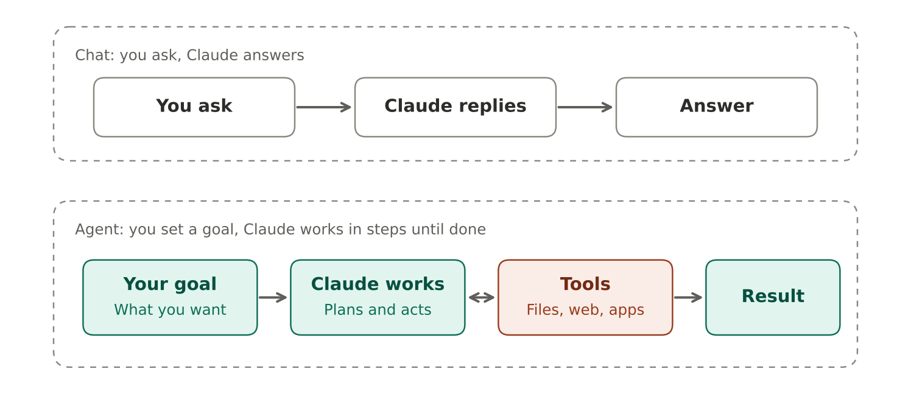

# Module 5: Meet Claude

<div class="doc-header-badges">
  <span class="badge badge-surface">Part A: AI Fundamentals</span>
  <span class="badge badge-level">Module 5 of 5</span>
  <span class="badge badge-verified">Attribution: Tactive AI Team</span>
</div>

<div class="module-video-wrapper" data-module="module-05" data-video-title="Module 5: Meet Claude">
  <div class="video-container">
    <div class="video-placeholder">
      <div class="video-placeholder-frame">
        <div class="video-placeholder-icon">
          <svg viewBox="0 0 24 24" width="44" height="44" fill="none" stroke="currentColor" stroke-width="1.8" stroke-linecap="round" stroke-linejoin="round" aria-hidden="true">
            <polygon points="5 3 19 12 5 21 5 3"></polygon>
          </svg>
        </div>
        <div class="video-placeholder-meta">
          <span class="video-tag">Module Video</span>
          <h3 class="video-title">Module 5: Meet Claude</h3>
          <p class="video-status">Video will be available soon</p>
          <p class="video-hint">Local MP4 upload pending in <code>docs/assets/videos/module-05.mp4</code></p>
        </div>
      </div>
    </div>
  </div>
</div>

**Claude** is an AI assistant developed by Anthropic. It is built on an LLM foundation, so everything you learned in Modules 1 through 4 applies directly to it.

---

## Different Models

Claude does not come in a single fixed version. It is offered in different **models**:

- **Smaller models:** Faster and lower cost; ideal for quick edits, classification, and straightforward questions.
- **Larger models:** Deeply capable and sophisticated; ideal for complex multi-step reasoning, nuanced drafting, and coding.

*(You will learn how to select between models in [Part B, Module 6: Types of Models](../part-b/module-06-types-of-models.md#the-idea-in-brief).)*

---

## Ways to Use Claude

| Way to Use | What It Is | Who It's For |
| :--- | :--- | :--- |
| **Claude App** *(Web, Desktop, Mobile)* | Chat with Claude, attach files, generate visual artifacts, and get help with everyday work | Everyone in the company |
| **Claude Code** | Claude working directly inside a local software project, able to edit files and run commands | Developers and technical teams ([Set up Claude Code on Windows](../part-b/setup-windows.md) & [Module 11](../part-b/module-11-tools-and-harness.md#the-harness-giving-tools-to-the-brain)) |
| **API** | Direct programmatic interface connecting external software systems to Claude | Developers building custom applications |

---

## Chat vs. Agent

Understanding this distinction is critical as you advance:

- **In a Chat:** You ask a question, Claude writes an answer, and you decide what happens next.
- **With an Agent:** You give a high-level goal, and Claude works through multiple steps on its own—opening files, running calculations, using tools, and reviewing its own results (explored in depth in [Part B, Module 12: Agents](../part-b/module-12-agents.md#chat-vs-agent-the-shift-from-conversation-to-delegation)).


*Figure 5: Chat compared with an agent*

=== "Chat Workflow (Turn-by-Turn Human Coordination)"
    ```mermaid
    sequenceDiagram
        autonumber
        actor User as Human User
        participant Claude as Claude (Chat)
        User->>Claude: "Draft an email about Q3 budget"
        Claude-->>User: Returns drafted text
        Note over User: Human copies draft, checks spreadsheet, spots missing metric
        User->>Claude: "Include total OPEX of $1.2M"
        Claude-->>User: Returns updated draft
        Note over User: Human manually copies into Outlook and sends
    ```

=== "Agent Workflow (Autonomous Delegation via Claude Code)"
    ```mermaid
    sequenceDiagram
        autonumber
        actor User as Human User
        participant Agent as Claude Code (Agent)
        participant Tools as System Tools & Files
        User->>Agent: "Summarize Q3 budget in budget-summary.md"
        loop Autonomous Agent Loop
            Agent->>Tools: Read(Q3-budget.xlsx)
            Tools-->>Agent: Raw table data
            Agent->>Tools: Write(budget-summary.md)
            Tools-->>Agent: File written
        end
        Agent-->>User: "Summary generated with OPEX $1.2M. View with /diff."
    ```

---

## Three Habits for Good Results

Whenever you prompt Claude, build these three habits into your request (expanded into four parts in [Part B, Module 8: Prompting](../part-b/module-08-prompting.md#the-four-parts-of-a-good-request)):

1. **Give Context:** Say who you are, what the business situation is, and who the intended audience is.
2. **State the Goal:** State clearly and unambiguously what you want produced.
3. **Ask for the Format:** Specify the output structure (e.g., *"a short email"*, *"a 3-column table"*, or *"5 bullet points under 20 words each"*).

### Comparing Requests

> **Weak Request:**
> *"Write something about the meeting change."*

> **Better Request:**
> *"I'm a team lead. Write a short email to my team of 10 explaining that our weekly sync is moving from Monday to Tuesday at 10:00 AM, starting next week. Keep the tone friendly, and keep the email under 80 words."*

---

## Try It: Your First Real Work Task

> [!TIP]
> **Hands-On Exercise:** Pick one of the three everyday work tasks you wrote down during Module 1.
> 
> 1. Formulate a prompt using the **Three Habits** (Context, Goal, Format).
> 2. Submit it to Claude (see [Ways to Use Claude](#ways-to-use-claude)).
> 3. Review the result using the **Trust Rule** (check in proportion to stakes).
> 4. Note down: What worked well? What required a follow-up correction?

---

<div class="hero-actions">
  <a href="../module-04-strengths-limits-trust/" class="md-button">← Module 4: Strengths, Limits, and Trust</a>
  <a href="../glossary/" class="md-button md-button--primary">Next: Part A Glossary →</a>
</div>
