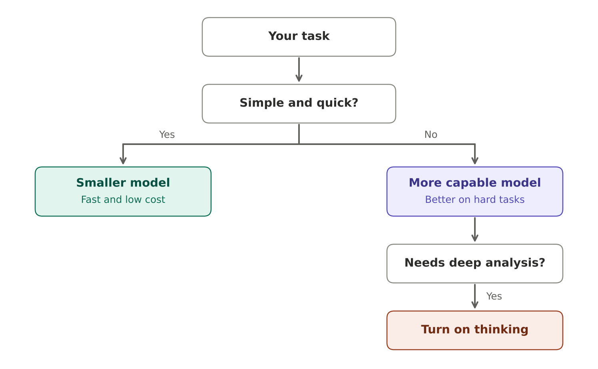

# Module 6: Types of Models

  Part B: AI Concepts
  Module 6 of 8
  Attribution: Tactive AI Team

  

    

      

        

          <svg viewBox="0 0 24 24" width="44" height="44" fill="none" stroke="currentColor" stroke-width="1.8" stroke-linecap="round" stroke-linejoin="round" aria-hidden="true">
            <polygon points="5 3 19 12 5 21 5 3"></polygon>
          </svg>
        

        

          Module Video
          <h3 class="video-title">Module 6: Types of Models</h3>
          
Video will be available soon

          
Local MP4 upload pending in <code>docs/assets/videos/module-06.mp4</code>

        

      

    

  

In Part A you learned that a model is the trained "brain" behind an AI tool. Claude is not one single model. It is a family of models, and you can choose between them depending on the difficulty and speed requirements of your task.

---

## Model Tiers: Small, Medium, and Large

Think of hiring help in an office. You would not ask a senior specialist to sort the incoming mail, and you would not ask a brand-new trainee to review a complex multi-million dollar vendor contract. AI models work the same way.

| Tier | Good For | Trade-Off |
| :--- | :--- | :--- |
| **Smaller & Faster** | Quick edits, sorting, simple questions, short summaries | Less depth and nuance on complex problems |
| **Balanced (Mid-Range)** | Most everyday work: drafting, analysis, spreadsheets | A sensible middle ground between speed and quality |
| **Most Capable** | Hard, multi-step, high-stakes, or heavy analytical tasks | Slower and costs more to run |

Claude's models are named by tier (for example, **Haiku** for fast tasks, **Sonnet** for balanced daily intelligence, and **Opus** for deep research and heavy writing).

> [!NOTE]
> **Example (Asha's Task Choice):**
> Asha wants to fix typos in a short team email. A smaller, faster model is perfect. Later, she needs to compare three complex vendor quotes for an offsite event and highlight hidden service fees. That is a job for a more capable model.

---

## Standard Models vs. Thinking (Reasoning) Models

A **standard model** answers right away, like answering a question off the top of your head.

A **reasoning or thinking model** works through the problem step by step first, like working it out on scratch paper before giving the final answer. It takes longer and uses more computational allowance, but it performs dramatically better on difficult problems such as complex numerical analysis, system architecture, and tricky logic.

Many Claude models can be instructed to think before answering. In the Claude app, this is often a setting you can switch on when a task requires deep reflection.

> [!NOTE]
> **Example (When to Think):**
> - *"Which supplier quote is cheaper once volume discounts, shipping surcharges, and tax are included?"* A thinking model calculates each sub-total carefully on scratch paper and is far less likely to slip.
> - *"Rewrite this sentence to sound friendlier."* This does not need extended thinking at all.

*Figure 6: A simple way to choose a model*

> [!WARNING]
> Thinking does not guarantee a 100% correct answer every time. Always continue checking important results using the **Trust Rule** from Part A.

---

## Multimodal Models: Models That Can See

Multimodal models work with more than plain text. You can share a photo of a whiteboard diagram, a scanned PDF invoice, an architectural sketch, or a financial chart, and ask Claude to inspect and explain it.

> [!NOTE]
> **Example (Asha's Whiteboard):**
> After a quarterly planning session, Asha photographs the physical whiteboard and asks Claude to transcribe it into a typed action list grouped by owner and due date.

---

> [!TIP]
> **Remember:** Match the model to the task. Start with a balanced model (like Sonnet), move to a smaller one (like Haiku) for simple jobs, and use a more capable one or turn on extended thinking when the task is difficult. Bigger is not always better.

---

## Related Concepts & Cross-References

- **[Part A, Module 2: What Is an LLM?](../part-a/module-02-what-is-an-llm.md)** — Understanding how models predict tokens and why output variation occurs.
- **[Part A, Module 5: Meet Claude](../part-a/module-05-meet-claude.md#different-models)** — Introduction to smaller vs. larger models.
- **[Part B, Module 7: Context](module-07-context.md)** — How your choice of model impacts context capacity and speed.
- **[Part B Glossary: Model Tiers](glossary.md#model-tier)** — Plain-English definition of model sizes and reasoning models.

---

  <a href="../" class="md-button">← Part B Overview</a>
  <a href="../module-07-context/" class="md-button md-button--primary">Next: Module 7 — Context →</a>

