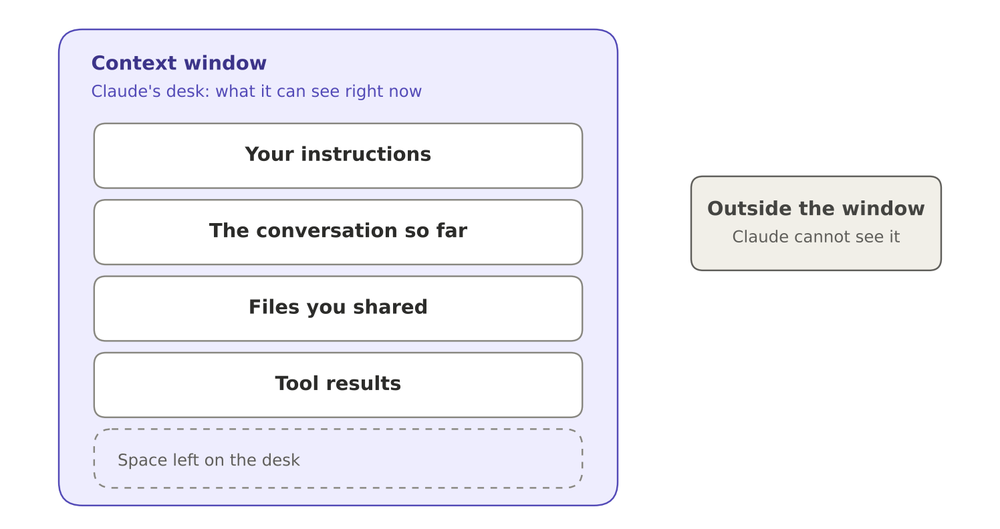

# Module 7: Context

  Part B: AI Concepts
  Module 7 of 8
  Attribution: Tactive AI Team

  

    

      

        

          <svg viewBox="0 0 24 24" width="44" height="44" fill="none" stroke="currentColor" stroke-width="1.8" stroke-linecap="round" stroke-linejoin="round" aria-hidden="true">
            <polygon points="5 3 19 12 5 21 5 3"></polygon>
          </svg>
        

        

          Module Video
          <h3 class="video-title">Module 7: Context</h3>
          
Video will be available soon

          
Local MP4 upload pending in <code>docs/assets/videos/module-07.mp4</code>

        

      

    

  

**Context** is everything Claude can see at the exact moment it generates an answer. This is one of the most critical concepts in working with AI systems, because Claude can only reason over what is placed in front of it.

---

## The Desk Analogy

Picture Claude sitting at a physical desk. Only the papers placed on top of that desk are available for Claude to inspect.

The desk holds four specific kinds of material:

1. **Your instructions:** What you typed in your latest prompt.
2. **The conversation so far:** All earlier questions and replies in the active chat.
3. **Files you shared:** Attached PDF documents, spreadsheets, code snippets, or images.
4. **Tool results:** Data Claude retrieved using a [tool](module-11-tools-and-harness.md#tools-the-models-hands) (such as live web search results).

*Figure 7: Claude can only work with what is on its desk*

> [!IMPORTANT]
> **Anything not on the desk does not exist for Claude.**
> It cannot see your company's internal shared drive, chats you had in a different browser tab, or an email you forgot to attach.

> [!NOTE]
> **Example (Asha's Missing Notes):**
> Asha types: *"Summarize yesterday's vendor meeting."* Claude politely replies that it cannot do so, because the meeting notes are not on its desk. Asha attaches the meeting memo and asks again—now Claude answers immediately and accurately.

---

## The Desk Has a Size Limit (The Context Window)

The **context window** is the physical surface area of the desk.

Claude features an industry-leading [context window](glossary.md#context-window) (typically 200,000 [tokens](../part-a/module-02-what-is-an-llm.md#tokens), roughly 150,000 words or 500 pages of text). While massive, the desk is still finite:

- In a very long, meandering conversation with dozens of back-and-forth turns, the desk fills up with old discussion.
- When the desk is cluttered, Claude may lose track of earlier constraints, repeat itself, or exhibit lower retrieval precision ("lost in the middle").

---

## Quality Matters More Than Quantity

A small, clean, highly relevant desk consistently beats a massive, cluttered one. If you upload an 80-page financial PDF when only two pages of revenue numbers matter, you force Claude to search through unnecessary noise.

### Best Practices for Context Management:
1. **Start a new chat for each new task:** Do not keep adding unrelated projects to one giant conversation.
2. **Share only the pages that matter:** If only Section 4 of a contract is relevant, paste Section 4 rather than the entire 120-page legal document.
3. **Summarize and reset:** In a long brainstorming chat, ask Claude: *"Summarize the three decisions we've agreed upon into a clean checklist."* Copy that checklist into a fresh chat and continue working.

---

> [!TIP]
> **Remember:** Claude knows only what is currently in its context. If an answer is inaccurate because vital information was missing, the fix is simple: put the missing information on the desk.

---

## Related Concepts & Cross-References

- **[Part A, Module 2: Tokens](../part-a/module-02-what-is-an-llm.md#tokens)** — How tokens define context window limits and processing costs.
- **[Part B, Module 8: Prompting & Instructions](module-08-prompting.md)** — Putting clear instructions and relevant context on the desk together.
- **[Part B, Module 9: Memory](module-09-memory.md)** — Preserving background information across new chats without cluttering context.
- **[Part B Glossary: Context & Context Window](glossary.md#context)** — Plain-English definitions of the desk metaphor and token ceilings.

---

  <a href="../module-06-types-of-models/" class="md-button">← Module 6: Types of Models</a>
  <a href="../module-08-prompting/" class="md-button md-button--primary">Next: Module 8 — Prompting and Instructions →</a>

