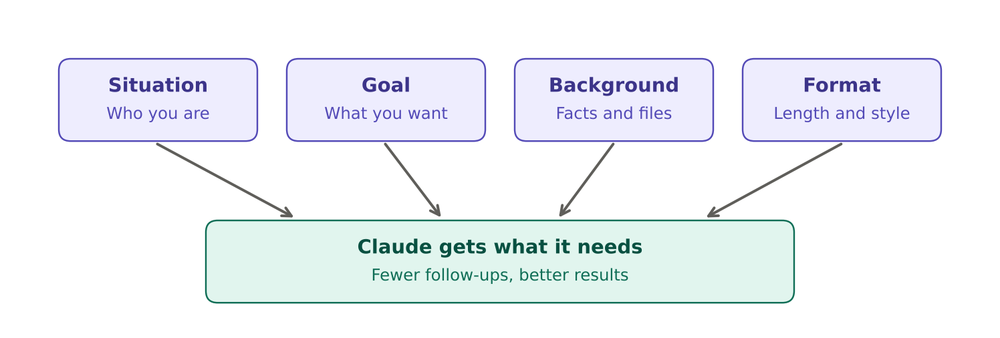

# Module 8: Prompting and Instructions

  Part B: AI Concepts
  Module 8 of 8
  Attribution: Tactive AI Team

  

    

      

        

          <svg viewBox="0 0 24 24" width="44" height="44" fill="none" stroke="currentColor" stroke-width="1.8" stroke-linecap="round" stroke-linejoin="round" aria-hidden="true">
            <polygon points="5 3 19 12 5 21 5 3"></polygon>
          </svg>
        

        

          Module Video
          <h3 class="video-title">Module 8: Prompting and Instructions</h3>
          
Video will be available soon

          
Local MP4 upload pending in <code>docs/assets/videos/module-08.mp4</code>

        

      

    

  

A **prompt** is simply the text you type to Claude. Prompting is the craft of asking clearly so you get the result you want without endless back-and-forth.

You do not need secret coding tricks or complex syntax. You only need to give Claude the same clear context you would give a smart new colleague who has just joined your team.

---

## The Four Parts of a Good Request

A complete, high-leverage prompt typically contains four elements:

| Part | What to Include |
| :--- | :--- |
| **1. Situation** | Who you are, the scenario, and who the intended reader is |
| **2. Goal** | Exactly what you want Claude to create or accomplish |
| **3. Background** | The core facts, constraints, files, or numbers needed to answer |
| **4. Format** | The desired length, layout (bullet list, table, memo), and tone |

*Figure 8: The four parts of a good request*

### Comparing Requests

> **Weak Request:**
> *"Summarize this."*

> **Better Request:**
> *"I'm preparing for a client meeting tomorrow morning. Summarize the attached vendor report in five concise bullet points, focusing strictly on risks and cost increases. Keep each bullet point under 20 words."*

---

## Five Practical Prompting Techniques

### 1. Show an Example ([Few-Shot Prompting](glossary.md#few-shot-examples))
> *"Draft this announcement in the exact tone and style of the sample email pasted below: [paste sample]."*
A single concrete example teaches Claude formatting and voice faster than a paragraph of adjectives.

### 2. Set Explicit Negative Boundaries
> *"Do not use corporate buzzwords like 'synergy' or 'leverage'. If a numerical value is not explicitly in the attached document, state that it is missing rather than estimating."*

### 3. Break Complex Work into Sequential Steps
Do not ask for a 20-page document in one turn. Ask for an outline first:
> *"Propose a 4-part outline for this whitepaper. Stop and wait for my approval before drafting the sections."*

### 4. Let Claude Interview You
> *"Before you begin drafting the project charter, ask me up to three clarifying questions about the project constraints."*

### 5. Refine and Iterate in Follow-Up Turns
The first response is rarely final. Treat it as a first draft:
> *"Cut this in half, make the deadline bold, and soften the second paragraph."*

> [!NOTE]
> **Example (Asha's Iteration):**
> Asha asks Claude for a deadline reminder email. The initial draft is three paragraphs long. She replies: *"Cut this down to three sentences and make the Friday 3 PM deadline stand out."* Claude updates it immediately.

---

> [!TIP]
> **Remember:** Always provide **Situation, Goal, Background, and Format**. Spending an extra 30 seconds giving clear instructions up front saves ten minutes of follow-up corrections.

---

## Related Concepts & Cross-References

- **[Part A, Module 5: Three Habits for Good Results](../part-a/module-05-meet-claude.md#three-habits-for-good-results)** — Context, Goal, and Format fundamentals.
- **[Part B, Module 7: Context](module-07-context.md)** — Managing the active desk to ensure prompts have clear references.
- **[Part B, Module 10: Skills](module-10-skills.md)** — Turning recurring high-performing prompts into saved, reusable skills.
- **[Part B Glossary: Prompting & Few-Shot](glossary.md#prompting)** — Plain-English definitions of prompt engineering techniques.

---

  <a href="../module-07-context/" class="md-button">← Module 7: Context</a>
  <a href="../module-09-memory/" class="md-button md-button--primary">Next: Module 9 — Memory →</a>

