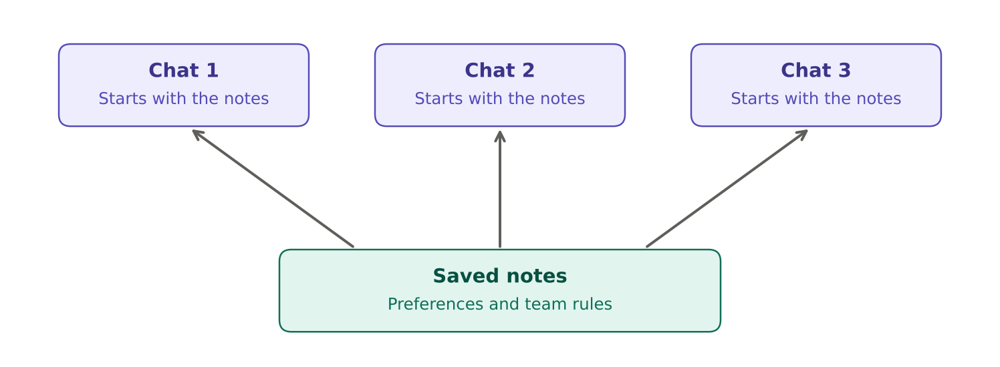

# Module 9: Memory

  Part B: AI Concepts
  Module 9 of 8
  Attribution: Tactive AI Team

  

    

      

        

          <svg viewBox="0 0 24 24" width="44" height="44" fill="none" stroke="currentColor" stroke-width="1.8" stroke-linecap="round" stroke-linejoin="round" aria-hidden="true">
            <polygon points="5 3 19 12 5 21 5 3"></polygon>
          </svg>
        

        

          Module Video
          <h3 class="video-title">Module 9: Memory</h3>
          
Video will be available soon

          
Local MP4 upload pending in <code>docs/assets/videos/module-09.mp4</code>

        

      

    

  

Imagine working with a smart colleague who wakes up every single morning with complete amnesia about yesterday. To work productively together, you would leave a notebook on their desk that they read first thing every morning.

That is exactly how Claude's **memory** works.

---

## Claude Does Not Remember by Default

By default, every new conversation starts completely blank. Claude does not carry over what you discussed last Tuesday unless those notes are saved somewhere for it to read at the start of the new chat.

---

## Short-Term vs. Saved (Persistent) Memory

| Kind of Memory | What It Is | How Long It Lasts |
| :--- | :--- | :--- |
| **Short-Term Memory** | The active conversation (the current context desk from Module 7) | Disappears when you start a new chat |
| **Saved (Persistent) Memory** | Standing notes stored in a file or setting that Claude reads at the start of future sessions | Persists until you edit or delete it |

*Figure 9: Saved notes are read at the start of each new chat*

---

## Three Ways Saved Memory Is Implemented

Depending on which Claude surface you use, saved notes take different forms:

1. **Memory Feature in the Claude App:** A built-in preference list where Claude remembers your job title, common formats, and team guidelines. You can inspect, edit, or delete items at any time.
2. **Project Instructions:** Standing system instructions attached to a **Claude Project** (available on paid plans). Every conversation inside that project automatically inherits these rules.
3. **Instruction File (`CLAUDE.md` in Claude Code):** A Markdown file located in your project folder that Claude Code reads automatically whenever you launch a terminal session.

> [!NOTE]
> **Example (Asha's Saved Notes):**
> Asha saves this standing note in her Project:
> *"I'm a team lead in Engineering Operations. Status reports must always be short bullet points with no corporate jargon. Format all dates as DD/MM/YYYY. The weekly team report is sent every Friday afternoon."*
> 
> Now, whenever Asha opens a new chat inside that project, she never has to repeat those preferences.

---

## What to Store vs. What Never to Store

### Good to Store:
- Your role, department, and primary responsibilities.
- Standard team formatting conventions (date formats, spelling styles).
- Frequently referenced background facts (project names, team size).
- Tone preferences (*"Direct, concise, bullet points"*).

### Never Store:
- Passwords, access tokens, or private credentials ([Part A, Module 4: Privacy Basics](../part-a/module-04-strengths-limits-trust.md#privacy-basics)).
- Customer personal data (PII) or sensitive customer lists ([Module 13: Permissions & Safety](module-13-permissions-and-safety.md)).
- Confidential executive salaries or non-public financial reports.

---

## Keep It Tidy

Old, contradictory, or outdated notes will produce confusing answers. Review your saved notes and Project instructions periodically.

> [!IMPORTANT]
> **Memory Is Not "Learning":**
> Having memory does not mean the underlying neural network is retraining itself. Memory is simply a structured set of notes that Claude reads onto its desk at the start of a conversation. You remain in complete control.

---

> [!TIP]
> **Remember:** Claude starts every chat with a blank slate. Saved notes are how you give it persistent context without retyping your background every morning. Store preferences, not secrets.

---

## Related Concepts & Cross-References

- **[Part A, Module 4: Privacy Basics](../part-a/module-04-strengths-limits-trust.md#privacy-basics)** — What never to store in memory (passwords, PII, client secrets).
- **[Part B, Module 7: Context](module-07-context.md)** — How saved memory automatically loads onto the active desk.
- **[Part B, Module 10: Skills](module-10-skills.md)** — Memory stores facts and preferences; skills store repeatable procedures.
- **[Part B, Module 13: Permissions & Safety](module-13-permissions-and-safety.md)** — Guarding confidential information in saved workspaces.
- **[Part B Glossary: Memory & Project Instructions](glossary.md#memory-saved-memory)** — Plain-English definitions of memory types.

---

  <a href="../module-08-prompting/" class="md-button">← Module 8: Prompting and Instructions</a>
  <a href="../module-10-skills/" class="md-button md-button--primary">Next: Module 10 — Skills →</a>

