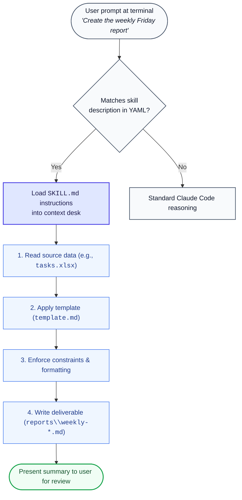

# Module 10: Skills

<div class="doc-header-badges">
  <span class="badge badge-surface">Part B: Claude Code & Agentic Systems</span>
  <span class="badge badge-level">Module 10 of 8</span>
  <span class="badge badge-verified">Attribution: Tactive AI Team</span>
</div>

<div class="module-video-wrapper" data-module="module-10" data-video-title="Module 10: Skills">
  <div class="video-container">
    <div class="video-placeholder">
      <div class="video-placeholder-frame">
        <div class="video-placeholder-icon">
          <svg viewBox="0 0 24 24" width="44" height="44" fill="none" stroke="currentColor" stroke-width="1.8" stroke-linecap="round" stroke-linejoin="round" aria-hidden="true">
            <polygon points="5 3 19 12 5 21 5 3"></polygon>
          </svg>
        </div>
        <div class="video-placeholder-meta">
          <span class="video-tag">Module Video</span>
          <h3 class="video-title">Module 10: Skills</h3>
          <p class="video-status">Video will be available soon</p>
          <p class="video-hint">Local MP4 upload pending in <code>docs/assets/videos/module-10.mp4</code></p>
        </div>
      </div>
    </div>
  </div>
</div>

---

## What Is a Skill in Claude Code?

In Claude Code, a **skill** is a packaged, reusable multi-step capability stored in a folder containing a **`SKILL.md`** file. For official specifications, visit the [Glossary: Progressive Disclosure](glossary.md#progressive-disclosure).

Once saved, a skill automatically becomes a custom slash command (such as `/weekly-report`) that you can invoke on demand. Furthermore, Claude Code can automatically discover and use the skill whenever you make a plain-English request that matches the skill's description.

---

## Where Skills Live on Windows

Skills can be scoped locally to a single project or globally across all projects on your machine, as detailed in [FAQ Question 7](faq.md#7-is-a-skill-the-same-thing-as-a-slash-command):

| Skill Scope | Folder Location | Who Can Use It | Documentation |
| :--- | :--- | :--- | :--- |
| **Project Skill** | `.claude\skills\<skill-name>\SKILL.md` in the project folder | Everyone working in this project. Shared via Git. | [Glossary: Progressive Disclosure](glossary.md#progressive-disclosure) |
| **Personal Skill** | `C:\Users\<you>\.claude\skills\<skill-name>\SKILL.md` | Only you, across every project on your Windows computer. | [Set up Claude Code on Windows](setup-windows.md) |

A skill folder can also contain companion assets, such as Markdown templates (`template.md`), schema examples, or helper scripts that the skill references.



---

## Step-by-Step: Building Asha's Weekly Report Skill

Follow along as Asha creates a standardized skill for her team's weekly status report:

### Step 1: Create the Skill Directory
In PowerShell (from your project directory), create the skill folder and open `SKILL.md` in Notepad:

```powershell
mkdir .claude\skills\weekly-report
notepad .claude\skills\weekly-report\SKILL.md
```

### Step 2: Author the `SKILL.md` File
Add the following content. The YAML frontmatter at the top (`name` and `description`) is what Claude reads to understand when to invoke the skill:

```markdown
---
name: weekly-report
description: Write the team's weekly status report from this week's task list. Use when asked for the weekly or Friday report.
---

# Weekly Report Workflow

1. Read the task list named by the user (default: tasks\this-week.xlsx).
2. Follow template.md in this folder: Done, In Progress, Risks, Next Week.
3. Maximum five short bullet points per section. No corporate jargon.
4. Validation check: verify that every metric total matches the source task list.
5. Format dates as Day Month Year (e.g., 20 November 2026).
6. Save the output as reports\weekly-<date>.md and display a summary before sharing.
```

### Step 3: Run and Test the Skill
Save and close Notepad, return to your Claude Code session, and execute:

```text
> /skills                       # list available skills; verify weekly-report appears
> /reload-skills                # reload skill definitions without restarting Claude Code
> /weekly-report                # execute the skill by its slash command name
> /weekly-report use @tasks\week47.xlsx   # execute with a specific input file
> write this week's report      # or ask in plain English; Claude auto-matches description
```

> [!TIP]
> **Auto-Generating Skills:** You can also ask Claude to package a successful workflow into a skill for you:
> ```text
> > turn what we just did into a project skill called weekly-report
> ```
> See how this connects to autonomous agents in [Module 12: Agents](module-12-agents.md#subagents-specialized-helpers-for-big-jobs).

---

## Skill vs. Prompt Comparison

| Aspect | One-Off Prompt | Saved Skill (`SKILL.md`) |
| :--- | :--- | :--- |
| **Definition** | A single request typed into the chat | A saved, version-controlled process in `.claude\skills\` |
| **User Effort** | Must be retyped and refined each time | Type once, invoke with `/<skill-name>` anytime |
| **Consistency** | Varies depending on phrasing and memory | Follows identical steps and checks every execution |
| **Team Sharing** | Difficult to distribute reliably | Commit `.claude\skills\` to Git and the whole team has it |

---

## How Skills Stay Efficient (Progressive Disclosure)

If Claude loaded the full text of 30 different skills into its context window at startup, your desk would immediately be cluttered with thousands of unnecessary tokens.

Claude Code uses **progressive disclosure**:
1. At session startup, Claude loads **only the short name and description** of each skill into memory.
2. Only when you run the command or ask for a matching task does Claude load the full instructions and companion templates onto the desk.
3. Run `/skill-doctor` inside a session to inspect how much context each skill consumes and how frequently each is used. Review [Module 7: Context Quality](module-07-context.md#the-desk-has-a-size-limit-the-context-window).

---

> [!NOTE]
> **Rule of Thumb:** If you explain the same multi-step procedure to Claude more than three times, save it as a skill in `.claude\skills\`.

---

## Practical Exercises

1. **Inspect Registered Skills:** Launch Claude Code and run `/skills`. Review the built-in and project-specific skills available in your workspace in the [Command Cheat Sheet](index.md#inside-claude-code-session-commands).
2. **Build a Formatting Skill:** Create `.claude\skills\clean-notes\SKILL.md` that takes raw meeting transcripts and formats them into Action Items, Decisions, and Attendees.
3. **Trigger via Natural Language:** Without typing `/clean-notes`, type `please clean up the meeting notes in @notes.txt` and verify that Claude autonomously invokes the skill.

---

## Knowledge Check

??? question "Where should a skill be stored if it should be accessible across all projects on your Windows PC?"
    **Answer:** In `C:\Users\<YourUsername>\.claude\skills\<skill-name>\SKILL.md`.

??? question "How does Claude Code know which skill to trigger when you ask a question in plain English?"
    **Answer:** It checks the `description:` field in each skill's YAML frontmatter to see if your request matches the stated purpose.

??? question "What command should you run after modifying a `SKILL.md` file to apply the changes immediately?"
    **Answer:** `/reload-skills`.

---

## Related Concepts & Cross-References

- **[Part B, Module 8: Prompting & Instructions](module-08-prompting.md)** — Turning proven prompts into permanent skills.
- **[Part B, Module 9: Memory](module-09-memory.md)** — How `CLAUDE.md` and skills complement each other.
- **[Part B, Module 11: Tools & The Harness](module-11-tools-and-harness.md)** — How skills leverage tools to execute work.
- **[Part B Glossary: Progressive Disclosure](glossary.md#progressive-disclosure)** — Plain-English explanation.

---

<div class="hero-actions">
  <a href="../module-09-memory/" class="md-button">← Previous: Module 9 — Memory</a>
  <a href="../module-11-tools-and-harness/" class="md-button md-button--primary">Next: Module 11 — Tools & The Harness →</a>
</div>
