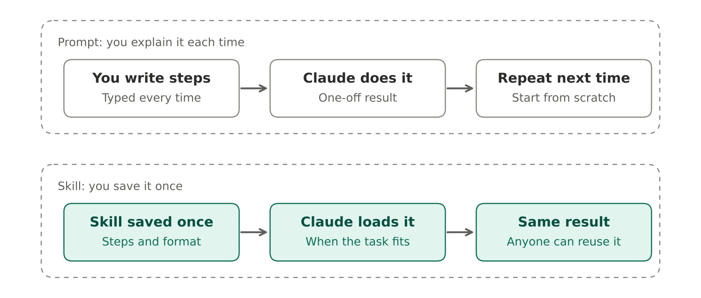

# Module 10: Skills

  Part B: AI Concepts
  Module 10 of 8
  Attribution: Tactive AI Team

  

    

      

        

          <svg viewBox="0 0 24 24" width="44" height="44" fill="none" stroke="currentColor" stroke-width="1.8" stroke-linecap="round" stroke-linejoin="round" aria-hidden="true">
            <polygon points="5 3 19 12 5 21 5 3"></polygon>
          </svg>
        

        

          Module Video
          <h3 class="video-title">Module 10: Skills</h3>
          
Video will be available soon

          
Local MP4 upload pending in <code>docs/assets/videos/module-10.mp4</code>

        

      

    

  

Think about cooking from a favorite recipe card. Once you have a proven recipe that works every time, you don't reinvent the ingredients and cooking times from scratch every time you prepare dinner.

A **skill** is a recipe card for Claude.

---

## What a Skill Is

A skill is a saved, reusable package of instructions designed for one specific type of repeatable task. It typically contains:

- The exact sequence of steps Claude should follow.
- A required document template or output layout.
- The tone and style rules to enforce.
- A completion checklist to verify quality before Claude returns the output.

> [!NOTE]
> **Example (Asha's Weekly Report Skill):**
> Every Friday, Asha writes a weekly status report for senior management. She creates a "Weekly Status Report" skill that contains her four-section template, standard headings, bullet guidelines, and a rule to highlight blocked tasks in bold red text.
> 
> Now, Asha only needs to say: *"Write this week's report using my raw notes,"* and Claude executes the saved method flawlessly.

---

## Skill vs. Prompt

| Aspect | One-Off Prompt | Saved Skill |
| :--- | :--- | :--- |
| **What It Is** | A single, ad-hoc request ([Module 8](module-08-prompting.md)) | A saved, reusable recipe ([glossary](glossary.md#skill)) |
| **Effort** | You retype or copy-paste instructions every time | You write and test it once |
| **Consistency** | Varies depending on how much you type that day | Identical structure and quality every time |
| **Team Sharing** | Difficult to standardize across team members | Easy to share across an entire department |

*Figure 10: A prompt is typed each time, a skill is saved once*

---

## How Skills Stay Efficient (Context Conservation)

In advanced agentic environments (such as Claude Code or custom team harnesses), skills are designed to be context-efficient:

- Claude initially only sees a one-sentence summary of each available skill.
- When you request a task that matches a skill's description, Claude loads the full instructions onto its desk.
- This prevents your context desk (Module 7) from becoming cluttered with dozens of rules you aren't using right now.

---

## When to Turn a Prompt into a Skill

Create a skill whenever:

1. **You repeat yourself:** You find yourself typing the same instructions or constraints more than three times.
2. **Standardization matters:** The output must follow a strict corporate format, brand style, or compliance checklist.
3. **Collaboration is required:** Multiple colleagues on your team need to produce the same deliverable with consistent quality.

---

> [!TIP]
> **Remember:** If you explain the same multi-step task to Claude more than a few times, turn it into a saved skill. A well-crafted skill written by one person can elevate the productivity of an entire team.

---

## Related Concepts & Cross-References

- **[Part B, Module 8: Prompting & Instructions](module-08-prompting.md)** — Prompting is for one-off requests; skills are for reusable recipes.
- **[Part B, Module 9: Memory](module-09-memory.md)** — Storing background context in memory vs. procedures in skills.
- **[Part B, Module 11: Tools & The Harness](module-11-tools-and-harness.md)** — Combining skills with external tools for automated workflows.
- **[Part B, Module 12: Agents](module-12-agents.md)** — How autonomous agents load skills to execute complex assignments.
- **[Part B Glossary: Skill](glossary.md#skill)** — Plain-English definition and efficiency benefits of skills.

---

  <a href="../module-09-memory/" class="md-button">← Module 9: Memory</a>
  <a href="../module-11-tools-and-harness/" class="md-button md-button--primary">Next: Module 11 — Tools and the Harness →</a>

