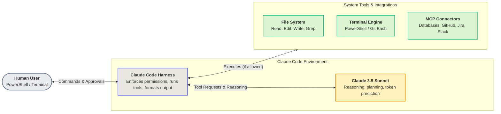

# Module 11: Tools and the Harness

<div class="doc-header-badges">
  <span class="badge badge-surface">Part B: Claude Code & Agentic Systems</span>
  <span class="badge badge-level">Module 11 of 8</span>
  <span class="badge badge-verified">Attribution: Tactive AI Team</span>
</div>

<div class="module-video-wrapper" data-module="module-11" data-video-title="Module 11: Tools and the Harness">
  <div class="video-container">
    <div class="video-placeholder">
      <div class="video-placeholder-frame">
        <div class="video-placeholder-icon">
          <svg viewBox="0 0 24 24" width="44" height="44" fill="none" stroke="currentColor" stroke-width="1.8" stroke-linecap="round" stroke-linejoin="round" aria-hidden="true">
            <polygon points="5 3 19 12 5 21 5 3"></polygon>
          </svg>
        </div>
        <div class="video-placeholder-meta">
          <span class="video-tag">Module Video</span>
          <h3 class="video-title">Module 11: Tools and the Harness</h3>
          <p class="video-status">Video will be available soon</p>
          <p class="video-hint">Local MP4 upload pending in <code>docs/assets/videos/module-11.mp4</code></p>
        </div>
      </div>
    </div>
  </div>
</div>

---

## The Harness: Giving Tools to the Brain

An AI model by itself is purely a text predictor: it cannot open a file on your hard drive, list directory contents, or check a webpage.

Claude Code acts as a **harness**: specialized software built around the model that provides it with **tools** and enforces **safety rules**. When Claude decides it needs to inspect a document or run a calculation, it asks the harness to execute the appropriate tool on your local Windows system and return the result. For architectural insights, see the [Glossary: Harness](glossary.md#harness).

Every time Claude uses a tool, you see an execution line on your screen, such as `Read(report.md)` or `PowerShell(dir)`.



---

<a id="tools-the-models-hands"></a>
## The Tools You Will See on Screen

The harness exposes built-in tools described in the [Command Cheat Sheet: Tools](index.md#inside-claude-code-session-commands):

| Tool Name on Screen | What It Does | Everyday Workplace Example | Official Reference |
| :--- | :--- | :--- | :--- |
| **`Read`** | Opens and reads a local file | Inspecting this week's task list spreadsheet or markdown notes | [The Tools You Will See on Screen](#tools-the-models-hands) |
| **`Edit` / `Write`** | Modifies an existing file or creates a new one | Saving an updated quarterly report or applying edits | [Module 12: Diff Review](module-12-agents.md#try-it-in-claude-code-agent-controls-safeguards) |
| **`Bash` or `PowerShell`** | Executes a terminal command | Listing directory files (`dir`), running Git commands | [Running Shell Commands with !](#running-shell-commands-directly-with) |
| **`Grep` / `Glob`** | Searches text inside files / finds files by pattern | Locating all files containing the word "budget" | [The Tools You Will See on Screen](#tools-the-models-hands) |
| **`WebSearch` / `WebFetch`** | Searches the web / loads a specific webpage URL | Checking public holiday schedules or API documentation | [The Tools You Will See on Screen](#tools-the-models-hands) |
| **`MCP Tools`** | Custom tools from connected enterprise apps | Fetching a Jira ticket, querying a database, or posting to Slack | [Connectors: MCP Servers](#connectors-model-context-protocol-mcp-servers) |

On Windows, Claude Code runs shell commands through **Git Bash** if Git for Windows (see [Set up Claude Code on Windows: Shells](setup-windows.md#5-git-for-windows-and-terminal-shells)) is installed, and through **PowerShell** if not.

---

## Everyday Scenario: Asha Observes the Harness in Action

> [!NOTE]
> **Asha's Transparency View:**
> When Asha asks Claude: *"Find all draft reports in the Q3 folder that mention supplier discounts,"* she watches the harness display its actions in sequence:
> 1. `Glob(Q3\*.md)` → Claude finds 4 matching files.
> 2. `Grep("supplier discount", Q3\*.md)` → Claude locates mentions in two files.
> 3. `Read(Q3\draft-october.md)` → Claude inspects the specific paragraphs.
>
> Because the harness displays every tool call transparently, Asha knows exactly which files Claude opened and can trust that no other files were touched.

---

## Try It in Claude Code

### Running Shell Commands Directly with `!`
You can execute terminal commands yourself without asking Claude to interpret them. Prefix the command with `!`, and the command output lands directly on Claude's desk using standard terminal syntax (see [Command Cheat Sheet](index.md#inside-claude-code-session-commands)):

```text
> !dir                  # run Windows dir command and put listing on the desk
> !git status           # inspect git status directly
```

### Inspecting and Diagnosing the Harness

```text
> /status      # view active version, model tier, account, and connection health
> /doctor      # diagnose setup, environment variables, and CLAUDE.md issues
> /tasks       # view background tasks, subagents, and long-running processes
> /config      # inspect and modify harness settings (theme, editor mode, defaults)
```
For command syntax and parameters, review the [Windows Command Cheat Sheet](index.md#inside-claude-code-session-commands).

---

## Connectors: Model Context Protocol (MCP) Servers

In Claude Code, external software connectors are called **MCP servers** ([Glossary: MCP Server](glossary.md#mcp-server-model-context-protocol)). MCP connects Claude to tools beyond your local hard drive, such as Jira, GitHub, Notion, PostgreSQL databases, or custom internal company APIs. MCP is an open standard connecting AI tools across platforms.

You manage MCP connectors from PowerShell before starting a session, or inside a session using slash commands before starting a session, or inside a session using slash commands:

```powershell
# In PowerShell: Add, list, and remove an HTTP-based MCP connector
claude mcp add --transport http notion https://mcp.notion.com/mcp
claude mcp list
claude mcp remove notion
```

Inside an active Claude Code session:

```text
> /mcp         # view active connectors, check authentication, and reconnect
```

> [!IMPORTANT]
> **The Same Brain, Different Capabilities:** This is why Claude in Claude Code feels so much more capable than Claude on the web. The underlying model is identical; the harness and tools surrounding it make the difference.

---

> [!TIP]
> **Harness Rule:** The model thinks, tools let it act, and the harness enforces the rules. Watch the tool lines on your screen to monitor exactly what Claude is doing. See this in practice in the [Worked Example](worked-example.md#step-6-the-autonomous-agent-loop-in-action).

---

## Practical Exercises

1. **Execute Shell Command with `!`:** In Claude Code, run `!dir`. Notice how the directory listing is returned immediately and becomes part of the conversation context.
2. **Run System Diagnostics:** Execute `/doctor`. Read through the diagnostic report to verify that your Node/executable environment and file permissions are properly configured. See [FAQ: Diagnostics](faq.md#3-windows-displays-an-error-claude-is-not-recognized-as-an-internal-or-external-command-how-do-i-fix-it).
3. **Inspect Active Status:** Type `/status` to confirm your active connection, current model, and project root path.

---

## Knowledge Check

??? question "What is the difference between the AI model and the harness?"
    **Answer:** The model is the neural network that predicts and reasons over text. The harness is the software wrapper that gives the model tools (file reading, editing, terminal commands) and enforces safety permissions.

??? question "How can you execute a Windows command like `dir` directly from the Claude Code prompt?"
    **Answer:** Prefix the command with an exclamation mark: `!dir`.

??? question "What protocol does Claude Code use to connect to external systems like Jira, Notion, or databases?"
    **Answer:** Model Context Protocol (MCP).

---

## Related Concepts & Cross-References

- **[Part B, Module 10: Skills](module-10-skills.md)** — How skills orchestrate tool calls.
- **[Part B, Module 12: Agents](module-12-agents.md)** — How agents use tools in autonomous iterative loops.
- **[Part B, Module 13: Permissions & Safety](module-13-permissions-and-safety.md)** — Controlling which tools Claude may run.
- **[Part B Glossary: Harness](glossary.md#harness)** — Plain-English definition.

---

<div class="hero-actions">
  <a href="../module-10-skills/" class="md-button">← Previous: Module 10 — Skills</a>
  <a href="../module-12-agents/" class="md-button md-button--primary">Next: Module 12 — Agents →</a>
</div>
