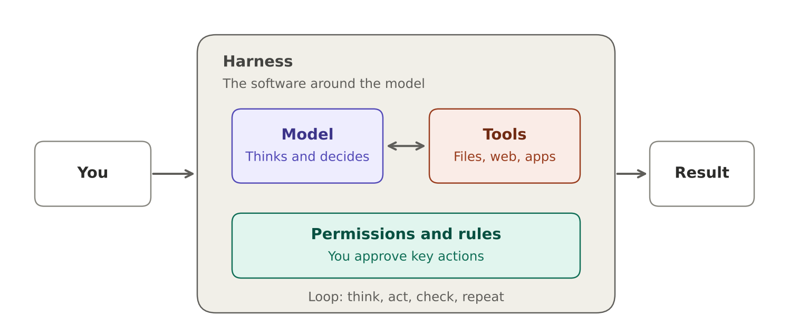

# Module 11: Tools and the Harness

  Part B: AI Concepts
  Module 11 of 8
  Attribution: Tactive AI Team

  

    

      

        

          <svg viewBox="0 0 24 24" width="44" height="44" fill="none" stroke="currentColor" stroke-width="1.8" stroke-linecap="round" stroke-linejoin="round" aria-hidden="true">
            <polygon points="5 3 19 12 5 21 5 3"></polygon>
          </svg>
        

        

          Module Video
          <h3 class="video-title">Module 11: Tools and the Harness</h3>
          
Video will be available soon

          
Local MP4 upload pending in <code>docs/assets/videos/module-11.mp4</code>

        

      

    

  

In Modules 1 through 10, Claude has primarily been writing text. But modern AI systems can also **take actions**—such as reading a file on your disk, querying a live database, executing code, or checking an arithmetic calculation.

This module explains the two components that make this possible: **tools** and the **harness**.

---

## Tools: The Model's Hands

A raw AI model on its own is like a brilliant researcher sitting in a locked room with no windows, who can only pass handwritten notes out through a slit under the door.

- It can reason, synthesize, and write beautiful essays.
- But it cannot open your files, browse the web, or check a calculation on its own.

**[Tools](glossary.md#tool) are the model's hands.** A tool is a specific software capability given to the model, such as:
- A file reader (to open spreadsheets, code, or PDFs).
- A calculator or code execution sandbox (to calculate exact numbers).
- A web search tool (to fetch real-time news).
- An application connector (to read calendar events or query Jira tickets).

---

## The Harness: The Complete Workshop

The **[harness](glossary.md#harness)** is the software system wrapped around the model. It:
1. Feeds the prompt into the model.
2. Provides the model with its menu of available tools.
3. Manages the execution loop (running tool requests and passing results back to the model).
4. Strictly enforces security and [permission rules](module-13-permissions-and-safety.md) on what the model may touch.

*Figure 11: The model works inside a harness that gives it tools and rules*

### Why the Same Model Behaves Differently in Different Places

You might notice that the exact same Claude model behaves differently inside the **Claude web app** compared to **Claude Code** in the terminal:

- The underlying "brain" (e.g., Claude 3.5 Sonnet) is identical.
- But the **harness** is different:
  - The Claude Web harness provides web search and interactive React Artifacts.
  - The Claude Code harness provides terminal commands, bash execution, and local file editing tools.

---

## Connectors

A **connector** is a specialized bridge provided by the harness that securely links Claude to external workplace applications (such as Google Drive, Slack, GitHub, or Microsoft 365). Connectors operate under strict permissions (Module 13).

---

> [!TIP]
> **Remember:** The model thinks. Tools let it act. The harness provides the tools and enforces the safety rules. You remain in control of what Claude is permitted to do.

---

## Related Concepts & Cross-References

- **[Part A, Module 5: Ways to Use Claude](../part-a/module-05-meet-claude.md#ways-to-use-claude)** — How different harness environments (App, CLI, API) provide different tool sets.
- **[Part B, Module 12: Agents](module-12-agents.md)** — How agents use tools inside the harness to carry out multi-step jobs.
- **[Part B, Module 13: Permissions & Safety](module-13-permissions-and-safety.md)** — Enforcing Allow, Ask, and Deny rules on tools and connectors.
- **[Part B Glossary: Tool, Harness & Connector](glossary.md#tool)** — Plain-English definitions of tools and execution environments.

---

  <a href="../module-10-skills/" class="md-button">← Module 10: Skills</a>
  <a href="../module-12-agents/" class="md-button md-button--primary">Next: Module 12 — Agents →</a>

