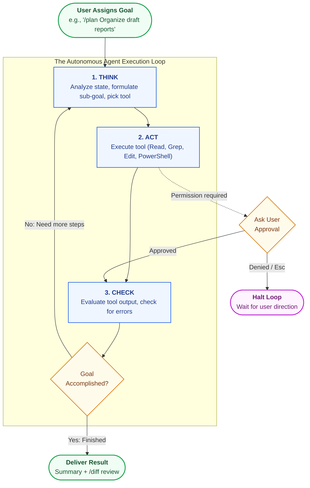

# Module 12: Agents

<div class="doc-header-badges">
  <span class="badge badge-surface">Part B: Claude Code & Agentic Systems</span>
  <span class="badge badge-level">Module 12 of 8</span>
  <span class="badge badge-verified">Attribution: Tactive AI Team</span>
</div>

<div class="module-video-wrapper" data-module="module-12" data-video-title="Module 12: Agents">
  <div class="video-container">
    <div class="video-placeholder">
      <div class="video-placeholder-frame">
        <div class="video-placeholder-icon">
          <svg viewBox="0 0 24 24" width="44" height="44" fill="none" stroke="currentColor" stroke-width="1.8" stroke-linecap="round" stroke-linejoin="round" aria-hidden="true">
            <polygon points="5 3 19 12 5 21 5 3"></polygon>
          </svg>
        </div>
        <div class="video-placeholder-meta">
          <span class="video-tag">Module Video</span>
          <h3 class="video-title">Module 12: Agents</h3>
          <p class="video-status">Video will be available soon</p>
          <p class="video-hint">Local MP4 upload pending in <code>docs/assets/videos/module-12.mp4</code></p>
        </div>
      </div>
    </div>
  </div>
</div>

---

## Chat vs. Agent: The Shift from Conversation to Delegation

In a standard chat interface, you ask a question, the AI gives an answer, and you manually copy-paste files or carry out the next step.

Claude Code operates as an **agent** by default: you give it a clear goal with boundaries, and it autonomously reads files, runs commands, evaluates outputs, corrects mistakes, and iterates until the goal is accomplished. Explore this complete flow in the [Worked Example: Asha\'s Report Workflow](worked-example.md).

| Dimension | Chat (Web Interface) | Agent (Claude Code) |
| :--- | :--- | :--- |
| **What You Provide** | A single question or prompt | A goal, target folders, and constraints |
| **Who Determines the Next Step** | You decide after each turn | Claude decides autonomously based on tool outputs |
| **What Is Delivered** | Text on a screen for you to read | Modified or newly created files, plus an executive summary |
| **Your Supervisory Role** | Micro-manage every individual message | Authorize the plan, monitor tool execution, review changes with `/diff` |

---

## The Agent Loop on Screen

When you assign a goal to Claude Code, you can watch the agent loop unfold in real time:

```text
       ┌──────────────┐
       │ 1. THINK     │  Formulate sub-goals and select tools
       └──────┬───────┘
              │
              ▼
       ┌──────────────┐
       │ 2. ACT       │  Execute tools (Read, Edit, Bash, Grep)
       └──────┬───────┘
              │
              ▼
       ┌──────────────┐
       │ 3. CHECK     │  Evaluate tool output and test results
       └──────┬───────┘
              │
              ▼
       ┌──────────────┐
       │ 4. REPEAT    │  Continue loop until goal met or user input needed
       └──────────────┘
```

The loop halts automatically when:
1. The objective is achieved.
2. A tool action requires your explicit permission (under your [permission rules](module-13-permissions-and-safety.md)).
3. You press **`Esc`** to pause or redirect execution.



---

## Everyday Scenario: Asha's File Organization Goal

**❌ Weak Goal:**
```text
> clean up the reports folder
```
*Why it fails:* "Clean up" is ambiguous. Claude might delete outdated drafts you needed to keep or rename files in an unexpected format.

**✅ Strong Goal:**
```text
> /plan In @Reports\ find every file with "draft" in its name and list
  them in a table with the date each was last changed. Do not delete or
  rename anything. Show me the list before you do anything else.
```

### The 4 Elements of a Reliable Agent Goal
1. **Goal:** Exactly what "finished" looks like (a table of draft files with last-modified dates).
2. **Where to Work:** The specific directory (`@Reports\`).
3. **Limits:** Negative constraints ("Do not delete or rename anything").
4. **Check-ins:** Milestones requiring human review ("Show me the list before you do anything else").

---

## Try It in Claude Code: Agent Controls & Safeguards

The following commands give you precise control over the agent loop, as detailed in the [Command Cheat Sheet: Agents](index.md#inside-claude-code-session-commands):

| Key or Command | When to Use It | Documentation Link |
| :--- | :--- | :--- |
| **`/plan <goal>`** | Claude researches the workspace and drafts an execution plan, but makes **no file modifications** until you explicitly approve. | [Glossary: Plan Mode](glossary.md#plan-mode) |
| **`Shift + Tab`** | Cycles through permission modes: **Normal** (ask before edits), **Accept Edits** (auto-approve edits), and **Plan** (read-only). Active mode displays beneath the prompt. | [Module 13: Permission Modes](module-13-permissions-and-safety.md#permission-modes-cycle-with-shift-tab) |
| **`Esc`** | Immediately pauses Claude. Progress so far is preserved, and you can redirect or refine the goal. | [FAQ Question 8: Stopping Claude](faq.md#8-how-do-i-stop-claude-immediately-if-it-starts-making-unexpected-changes) |
| **`Esc Esc` or `/rewind`** | Rolls back conversation history and file modifications to an earlier checkpoint. | [Glossary: Checkpoint / Rewind](glossary.md#checkpoint-rewind-rewind) |
| **`/diff`** | Displays a colored visual git diff of all file modifications before you accept or commit them. | [Worked Example: Step 8 Diff Review](worked-example.md#step-8-review-edits-with-diff) |
| **`/goal <condition>`** | Sets an explicit completion condition for long-running workflows. | [Command Cheat Sheet](index.md#inside-claude-code-session-commands) |
| **`/tasks`** | Shows background tasks and running helpers. | [Module 11: Inspecting the Harness](module-11-tools-and-harness.md#inspecting-and-diagnosing-the-harness) |
| **`claude -p "..."`** | Non-interactive headless execution from PowerShell for automated batch tasks. | [Set up Claude Code on Windows: Sessions](setup-windows.md#8-starting-resuming-and-leaving-sessions) |

---

## Subagents: Specialized Helpers for Big Jobs

For large tasks—such as auditing 50 separate files or running independent research paths—Claude Code can spawn **subagents**. A subagent runs on its own isolated desk with its own context window, executes its assignment, and reports back a concise summary to the main agent. Learn more in the [Glossary: Subagent](glossary.md#subagent).

You can request subagents directly in natural language:

```text
> Use a separate subagent for each file in @meeting-notes\ to extract its
  action items, then combine them into one master table with owners and due dates.
> /subtask check that every link in @handbook.md is valid and responsive
```

### Creating Reusable Subagents
You can define persistent, specialized subagents by creating a Markdown file in `.claude\agents\` (project) or `C:\Users\<you>\.claude\agents\` (personal) to execute focused tasks with custom tools:

```markdown
---
name: notes-reader
description: Reads one set of meeting notes and returns action items in three lines.
tools: Read, Grep
---
Read the notes file you are assigned. Return only action items: task, owner, and due date.
```
*Notice:* The `tools:` line enforces least-privilege security: this helper can only read and search files; it cannot edit, delete, or run terminal commands.

---

## Staying in Control

1. **Start Small:** Test instructions on a single sample folder before running across an entire project.
2. **Always Use `/plan` for Complex Tasks:** Review what Claude intends to do before approving file writes.
3. **Keep Your Finger Near `Esc`:** If you see an unexpected tool call on screen, press `Esc` immediately.
4. **Inspect Changes with `/diff`:** Never accept modifications blindly. Review the exact line-by-line diff. Follow Asha\'s complete execution in the [Worked Example](worked-example.md#step-6-the-autonomous-agent-loop-in-action).

---

> [!TIP]
> **Golden Habit:** Define clear goals with explicit limits. Start in `/plan` mode, monitor tool lines as they run, and know that `Esc` and `/rewind` are always available if you need to course-correct.

---

## Practical Exercises

1. **Run a Plan-Only Task:** Execute `/plan analyze the file structure in this folder and suggest three improvements`. Notice how Claude explores files without altering any data.
2. **Cycle Modes with `Shift + Tab`:** Press `Shift + Tab` repeatedly and observe the mode indicator switch between Normal, Accept Edits, and Plan.
3. **Inspect Edits with `/diff`:** Ask Claude to add a short note to a file, then run `/diff` to inspect the visual git diff before keeping the change.

---

## Knowledge Check

??? question "What is the primary difference between asking Claude a question in chat vs. giving Claude an agent goal?"
    **Answer:** In chat, Claude only gives you an answer to read. As an agent, Claude autonomously selects tools, reads files, executes steps, tests results, and delivers finished file modifications.

??? question "What key stops Claude immediately if you notice it executing an unintended command?"
    **Answer:** Press `Esc` once to pause execution, or press `Esc` twice (or type `/rewind`) to roll back changes.

??? question "Why are subagents useful for processing large batches of documents?"
    **Answer:** Each subagent runs on its own independent desk with its own context window, preventing the main conversation context from being overwhelmed and allowing parallel progress.

---

## Related Concepts & Cross-References

- **[Part B, Module 11: Tools & The Harness](module-11-tools-and-harness.md)** — Tools used within the agent loop.
- **[Part B, Module 13: Permissions & Safety](module-13-permissions-and-safety.md)** — Controlling what agents are allowed to do.
- **[Part B Worked Example: Asha's Report](worked-example.md)** — End-to-end demonstration of the agent loop.
- **[Part B Glossary: Agent Loop](glossary.md#agent-loop)** — Plain-English explanation.

---

<div class="hero-actions">
  <a href="../module-11-tools-and-harness/" class="md-button">← Previous: Module 11 — Tools & The Harness</a>
  <a href="../module-13-permissions-and-safety/" class="md-button md-button--primary">Next: Module 13 — Permissions & Safety →</a>
</div>
