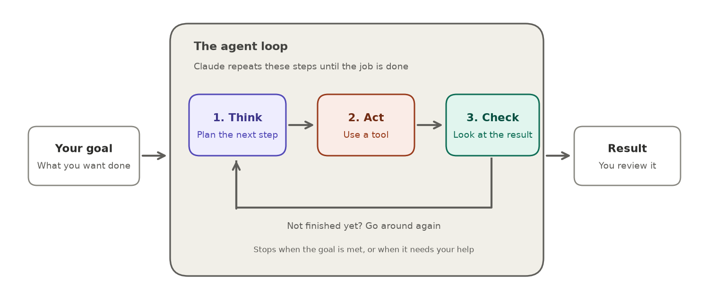

# Module 12: Agents

  Part B: AI Concepts
  Module 12 of 8
  Attribution: Tactive AI Team

  

    

      

        

          <svg viewBox="0 0 24 24" width="44" height="44" fill="none" stroke="currentColor" stroke-width="1.8" stroke-linecap="round" stroke-linejoin="round" aria-hidden="true">
            <polygon points="5 3 19 12 5 21 5 3"></polygon>
          </svg>
        

        

          Module Video
          <h3 class="video-title">Module 12: Agents</h3>
          
Video will be available soon

          
Local MP4 upload pending in <code>docs/assets/videos/module-12.mp4</code>

        

      

    

  

In Module 11, you saw that tools give Claude "hands" to perform tasks.

An **agent** is what you get when Claude uses those tools autonomously in an iterative loop to finish a complete, multi-step job—not just to answer a single question.

---

## Chat vs. Agent

Think about the difference between asking a coworker a quick factual question versus assigning that coworker an entire multi-day project:

| Dimension | Standard Chat | Autonomous Agent |
| :--- | :--- | :--- |
| **What You Give** | A question or specific instruction | A high-level goal and boundaries |
| **Who Decides Next Step** | **You** (you read the answer and decide what to ask next) | **Claude** (it plans and executes intermediate steps) |
| **What Comes Back** | Text to read | Finished work (edited files, created reports, validated data) |
| **Your Primary Role** | Guiding every single turn | Setting the goal and constraints, then reviewing the final output |

Both utilize the same underlying Claude model. The difference is how much autonomy the harness grants Claude to run tools without asking you at every step.

---

## The Agent Loop: Think, Act, Check

When Claude operates as an agent, it executes a continuous three-phase loop:

1. **Think:** Analyze the goal, inspect the current state, and plan the immediate next step.
2. **Act:** Use a tool (read a document, run a calculation, edit a line of text).
3. **Check:** Inspect the tool's result to confirm whether the step succeeded or failed.
4. **Repeat:** Continue the cycle until the goal is achieved or it needs your approval.

*Figure 12: An agent repeats think, act, check until the job is done*

> [!NOTE]
> **Example (Asha's Customer Feedback Task):**
> Asha instructs an agent: *"Identify the three most common complaints in this 500-line customer feedback CSV, calculate their percentage of total tickets, and write a summary memo."*
> 
> - **Step 1 (Act):** Claude opens the CSV file using a file reading tool.
> - **Step 2 (Act):** Claude runs code to count occurrences and calculate percentages.
> - **Step 3 (Check):** Claude verifies the percentages add up to 100%.
> - **Step 4 (Act):** Claude writes the summary memo and presents it for Asha's review.

---

## When to Use an Agent vs. a Normal Chat

### Use an Agent For:
- **Multi-step research and synthesis:** Gathering information across 10 documents, reconciling conflicting numbers, and generating a single report.
- **Auditing across many files:** Reviewing 25 supplier contracts against a compliance checklist.
- **Repetitive batch transformations:** Converting 50 meeting transcripts into structured action item summaries.

### Use a Normal Chat For:
- Quick questions, drafting an email, brainstorming ideas, or simple rewrites.
- An agent takes longer and consumes more computational budget; save it for tasks that genuinely require multi-step tool execution.

---

## Giving an Agent a Good Goal

A high-performing agent prompt requires four specific elements:

1. **Goal:** What the finished deliverable looks like.
2. **Workspace:** Exactly which files or folders it is allowed to open.
3. **Limits:** What it must **never** touch, change, or delete.
4. **Check-ins:** Specific points where it must pause and ask for your sign-off before proceeding.

### Comparing Agent Requests

> **Weak Request:**
> *"Clean up the reports folder."*

> **Better Request:**
> *"In the Reports folder, find every file with 'draft' in its filename. Create a Markdown table listing each file name and its last modified date. Do not delete, move, or rename any files. Show me the table before taking any further action."*

---

## Subagents: Helpers for Large Jobs

When a task is massive, Claude can spawn **[subagents](glossary.md#subagent)**—independent helpers assigned to handle sub-tasks.

- Each subagent operates with its own clean, isolated [context desk (Module 7)](module-07-context.md).
- Subagents can execute work in parallel without cluttering Claude's main desk.
- Once finished, each subagent returns a concise summary back to the main agent.

> [!NOTE]
> **Example (Asha's 15 Meeting Notes):**
> Asha needs action items extracted from 15 separate meeting transcripts. Instead of crowding all 15 transcripts onto one desk, Claude starts a subagent for each transcript. Each subagent reads its single document and reports back 3 key bullets. Claude combines the 15 bullet lists into a single master dashboard for Asha.

---

> [!TIP]
> **Remember:** An agent turns a high-level goal into finished work by looping through **Think, Act, and Check**. Always provide clear limits, set mandatory check-ins, and review the final output before relying on it.

---

## Related Concepts & Cross-References

- **[Part A, Module 5: Chat vs. Agent](../part-a/module-05-meet-claude.md#chat-vs-agent)** — The initial distinction between single-turn chat and multi-step agents.
- **[Part B, Module 7: Context](module-07-context.md)** — How subagents keep individual desks clean during complex jobs.
- **[Part B, Module 11: Tools & The Harness](module-11-tools-and-harness.md)** — The tools and environment required for agent loops.
- **[Part B, Module 13: Permissions & Safety](module-13-permissions-and-safety.md)** — Keeping agents safely bounded with Allow, Ask, and Deny rules.
- **[Part B Glossary: Agent, Loop & Subagent](glossary.md#agent)** — Plain-English definitions of agentic building blocks.

---

  <a href="../module-11-tools-and-harness/" class="md-button">← Module 11: Tools and the Harness</a>
  <a href="../module-13-permissions-and-safety/" class="md-button md-button--primary">Next: Module 13 — Permissions and Safety →</a>

