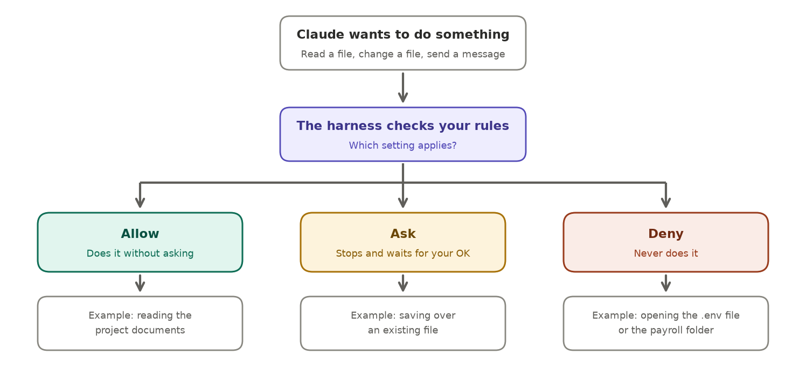

# Module 13: Permissions and Safety

<div class="doc-header-badges">
  <span class="badge badge-surface">Part B: AI Concepts</span>
  <span class="badge badge-level">Module 13 of 8</span>
  <span class="badge badge-verified">Attribution: Tactive AI Team</span>
</div>

<div class="module-video-wrapper" data-module="module-13" data-video-title="Module 13: Permissions and Safety">
  <div class="video-container">
    <div class="video-placeholder">
      <div class="video-placeholder-frame">
        <div class="video-placeholder-icon">
          <svg viewBox="0 0 24 24" width="44" height="44" fill="none" stroke="currentColor" stroke-width="1.8" stroke-linecap="round" stroke-linejoin="round" aria-hidden="true">
            <polygon points="5 3 19 12 5 21 5 3"></polygon>
          </svg>
        </div>
        <div class="video-placeholder-meta">
          <span class="video-tag">Module Video</span>
          <h3 class="video-title">Module 13: Permissions and Safety</h3>
          <p class="video-status">Video will be available soon</p>
          <p class="video-hint">Local MP4 upload pending in <code>docs/assets/videos/module-13.mp4</code></p>
        </div>
      </div>
    </div>
  </div>
</div>

Claude can only take actions that its harness permits. **Permissions** are the strict rules you define regarding what Claude is allowed to read, modify, execute, or send.

Permissions are what keep you safely in control when Claude operates as an autonomous agent.

---

## Why Permissions Matter: The Principle of Least Access

Think about handing keys to a newly hired contractor in an office building. You would give them a keycard that opens only the conference room and their assigned desk, never a master passkey that unlocks HR files, server rooms, and the executive suite.

In AI security, this is called the **Principle of Least Access**: granting an AI agent only the minimal permissions required to complete the specific job, and nothing more.

---

## The Three Permission Settings: Allow, Ask, Deny

Every action an agent attempts is checked against your permission rules:

| Setting | What It Means | Everyday Example |
| :--- | :--- | :--- |
| **[Allow](glossary.md#allow-ask-deny)** | Claude may perform this action freely without asking you | Reading markdown documents inside your project folder |
| **[Ask](glossary.md#allow-ask-deny)** | Claude must pause and wait for your explicit approval each time | Overwriting an existing file, running bash scripts, or sending an email |
| **[Deny](glossary.md#deny-rule)** | Claude is strictly forbidden from ever performing this action | Opening a file containing passwords, or reading a customer PII directory |

> [!IMPORTANT]
> **The Strictest Rule Always Wins:**
> If two permission rules ever conflict, the safer, stricter rule takes precedence: **Deny overrides Ask, and Ask overrides Allow.**


*Figure 13: Each action is checked against your rules: allow, ask, or deny*

---

## Keeping Claude Away from Sensitive Files

Certain files should always remain strictly out of an AI agent's reach:

- **[`.env` files](glossary.md#env-file):** Files used by software engineers to store database passwords, API keys, and production tokens. Claude virtually never needs to read them.
- **Customer Personal Data:** Spreadsheets containing customer names, credit card numbers, or medical records.
- **Payroll & HR Folders:** Personnel salary reviews, performance appraisals, and internal investigations.
- **Master Contract Repositories:** Signed legal agreements and confidential patent disclosures.

> [!NOTE]
> **Example (Asha's Payroll Folder Deny Rule):**
> Asha's workspace contains an internal folder called `/Payroll`. She configures a **Deny** rule for that folder. Later, she asks Claude: *"Summarize every document in this workspace."* Claude reads all project documents, skips `/Payroll`, and explicitly logs: *"Skipped /Payroll due to security denial rule."*

---

## Configuring Permissions in Claude Code

In developer environments like Claude Code, permissions are managed through a configuration file located at `.claude/settings.json`:

```json
{
  "permissions": {
    "deny": [
      "Read(./.env)",
      "Read(./secrets/**)",
      "Read(./payroll/**)"
    ]
  }
}
```

- `Read(./.env)` blocks Claude from opening the `.env` secret file.
- `Read(./secrets/**)` recursively blocks access to everything inside the `secrets` folder.
- In the Claude Code terminal, you can type `/permissions` at any time to inspect or modify these boundaries interactively.

---

## Approval Prompts: Read Before You Click

When an action is set to **Ask**, Claude halts execution and presents an approval prompt explaining:
1. What tool it wants to run.
2. Which file it wants to edit or delete.
3. The exact code or command it intends to execute.

> [!WARNING]
> **Never blindly click "Approve All":**
> Take 5 seconds to read what the agent is about to modify. If an agent offers to *"Remember this answer for future sessions"*, only select that option for safe read-only operations—never for file deletions or external network requests.

---

## Good Security Habits

1. **Start Strict and Loosen Later:** It is far safer to start with strict Deny/Ask rules and relax them as needed than to recover from an accidental file deletion.
2. **Deny Secrets Before Starting:** Add `.env` and credential files to your deny list on day one.
3. **Work on Copies or Git Branches:** When running agents on important code or documents, work on a separate branch or duplicate folder so originals remain untouched.
4. **Follow Corporate Policy:** Always adhere to your company's data governance standards.

---

> [!TIP]
> **Remember:** Permissions govern what Claude may do on its own. **Allow** what is safe, **Ask** for what has consequences, and **Deny** what is sensitive. You remain accountable for the final outcome.

---

## Related Concepts & Cross-References

- **[Part A, Module 4: Privacy Basics](../part-a/module-04-strengths-limits-trust.md#privacy-basics)** — Corporate data protection principles and avoiding secret leakage.
- **[Part B, Module 11: Tools & The Harness](module-11-tools-and-harness.md)** — How the software harness enforces permission checks before running tools.
- **[Part B, Module 12: Agents](module-12-agents.md)** — Setting human-in-the-loop checkpoints during autonomous agent loops.
- **[Part B Glossary: Permissions, Allow/Ask/Deny & Least Access](glossary.md#permissions)** — Plain-English vocabulary for permission models.

---

<div class="hero-actions">
  <a href="../module-12-agents/" class="md-button">← Module 12: Agents</a>
  <a href="../worked-example/" class="md-button md-button--primary">Next: Putting It All Together (Worked Example) →</a>
</div>
