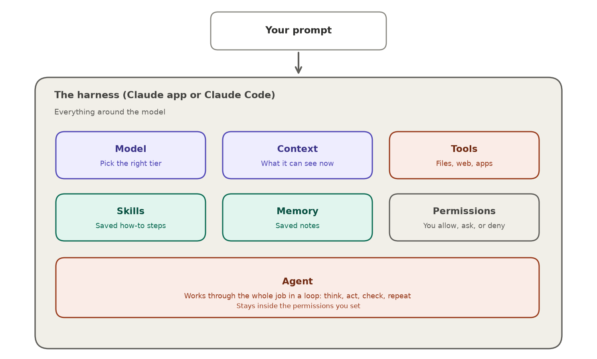

# Putting It All Together: Worked Example

  Part B: AI Concepts
  Synthesis & Practical Application
  Attribution: Tactive AI Team

To see how the eight architectural ideas from Modules 6 through 13 integrate in real workplace scenarios, let's look at one complete, end-to-end example: **Asha's Weekly Status Report Assistant**.

---

## The Complete Architectural Picture

*Figure 14: The ideas from Modules 6 to 13 in one picture*

---

## How Each Idea Appears in the Scenario

| Concept | How It Appears in Asha's Workflow |
| :--- | :--- |
| **[Model (Module 6)](module-06-types-of-models.md)** | A **balanced model** (like Sonnet) handles the initial drafting and text synthesis. **Extended thinking** is toggled on only if financial or billing numbers require multi-step verification. |
| **[Context (Module 7)](module-07-context.md)** | Asha keeps the desk clean: she places only this week's raw task list and last week's summary on the desk, excluding 50 pages of irrelevant meeting chatter. |
| **[Prompt (Module 8)](module-08-prompting.md)** | Asha provides **Situation, Goal, Background, and Format**: *"I'm the team lead. Write this week's status report as five concise bullet points for the VP of Engineering."* |
| **[Memory (Module 9)](module-09-memory.md)** | A persistent saved note stores Asha's job title, her team's preferred date format (`DD/MM/YYYY`), and standing tone preferences so she never retypes them. |
| **[Skill (Module 10)](module-10-skills.md)** | A reusable **Weekly Status Report Skill** contains the standardized 4-part corporate template, section ordering, and final quality checklist. |
| **[Tools & Harness (Module 11)](module-11-tools-and-harness.md)** | The harness gives Claude a file-reading tool to inspect the task spreadsheet and a calculation tool to verify delivery percentages. |
| **[Agent (Module 12)](module-12-agents.md)** | Claude acts as an autonomous agent: it loops through reading the task list, summing project hours, checking metrics, drafting the report, and verifying claims against the data before presenting it. |
| **[Permissions (Module 13)](module-13-permissions-and-safety.md)** | The harness enforces strict rules: Claude has **Allow** permission to read the team folder, **Ask** permission before saving any file, and **Deny** protection blocking access to `/Payroll` and `.env` credentials. |

---

## Core Takeaways

> [!IMPORTANT]
> **No Single Idea Works in Isolation:**
> High-performance AI workflows do not depend on "one magical prompt." Superior, reliable results come from the harmonious integration of all eight building blocks:
> 1. Choosing the right **model tier**.
> 2. Keeping the **context desk** clean.
> 3. Crafting a clear, structured **prompt**.
> 4. Saving persistent background in **memory**.
> 5. Standardizing repeatable methods into **skills**.
> 6. Giving the model the right **tools** inside a secure **harness**.
> 7. Letting Claude work through multi-step goals as an **agent**.
> 8. Enforcing strict safety boundaries with **permissions**.

---

## Module Navigation for the Eight Ideas

Review each individual component of Asha's workflow in its dedicated module:

1. **[Module 6: Types of Models](module-06-types-of-models.md)** — Choosing the right model tier for data processing and drafting.
2. **[Module 7: Context](module-07-context.md)** — Keeping the active desk clean and focused on this week's tickets.
3. **[Module 8: Prompting & Instructions](module-08-prompting.md)** — Crafting structured requests using Situation, Goal, Background, and Format.
4. **[Module 9: Memory](module-09-memory.md)** — Storing persistent team background and project rules across chats.
5. **[Module 10: Skills](module-10-skills.md)** — Saving the weekly report template, tone, and checklist as a reusable recipe.
6. **[Module 11: Tools & The Harness](module-11-tools-and-harness.md)** — Giving Claude access to the ticketing system via secure connectors.
7. **[Module 12: Agents](module-12-agents.md)** — Letting Claude coordinate the multi-step retrieval and drafting process autonomously.
8. **[Module 13: Permissions & Safety](module-13-permissions-and-safety.md)** — Setting ticket read to Allow and email send to Ask for human sign-off.

---

  <a href="../module-13-permissions-and-safety/" class="md-button">← Module 13: Permissions and Safety</a>
  <a href="../glossary/" class="md-button md-button--primary">Next: Part B Glossary →</a>

