# AI MASTERCLASS
## Internal AI Learning Documentation Portal

  Curriculum: Company AI Training
  Scope: AI Fundamentals & Systems Concepts
  Attribution: Tactive AI Team

  

    

      Welcome to <strong>AI MASTERCLASS</strong>, our company's internal documentation and learning portal for artificial intelligence. Sourced strictly from our foundational training curriculum, this portal provides a structured, plain-English roadmap to understanding AI assistants, mastering Large Language Models, and safely applying AI systems in your daily work.
    

    

      <a href="foundations/part-a/" class="md-button md-button--primary">Explore Part A: Fundamentals (Modules 1–5) →</a>
      <a href="foundations/part-b/" class="md-button">Explore Part B: Systems Concepts (Modules 6–13) →</a>
    

  

---

## The Two Core Learning Tracks

```mermaid
flowchart LR
    subgraph TrackA["Part A: AI Fundamentals"]
        direction TB
        A1["Module 1: What Is AI?"]
        A2["Module 2: What Is an LLM?"]
        A3["Module 3: How Does an LLM Work?"]
        A4["Module 4: Strengths, Limits, and Trust"]
        A5["Module 5: Meet Claude"]
    end

    subgraph TrackB["Part B: AI Concepts for Working with Systems"]
        direction TB
        B1["Module 6: Types of Models"]
        B2["Module 7: Context"]
        B3["Module 8: Prompting & Instructions"]
        B4["Module 9: Memory"]
        B5["Module 10: Skills"]
        B6["Module 11: Tools & The Harness"]
        B7["Module 12: Agents"]
        B8["Module 13: Permissions & Safety"]
    end

    TrackA --> TrackB
    TrackB --> Capstone["Worked Example:<br/>Asha's Weekly Report"]
```

---

  

    
🌱

    <h3>Part A: AI Fundamentals</h3>
    
A beginner's guide to understanding what AI is, how Large Language Models work in simple terms, what they do well, where they go wrong, and how to complete your first real work task.

    <ul>
      <li><strong><a href="foundations/part-a/module-01-what-is-ai/">Module 1: What Is AI?</a></strong> — Broad definitions, machine learning, and general-purpose assistants.</li>
      <li><strong><a href="foundations/part-a/module-02-what-is-an-llm/">Module 2: What Is an LLM?</a></strong> — Token-by-token prediction and why answers differ.</li>
      <li><strong><a href="foundations/part-a/module-03-how-llms-work/">Module 3: How Does an LLM Work?</a></strong> — Pretraining, fine-tuning, knowledge cutoffs, and hallucinations.</li>
      <li><strong><a href="foundations/part-a/module-04-strengths-limits-trust/">Module 4: Strengths, Limits, and Trust</a></strong> — What AI does well, uneven skill, trust rules, and privacy.</li>
      <li><strong><a href="foundations/part-a/module-05-meet-claude/">Module 5: Meet Claude</a></strong> — Model sizes, chat vs. agents, and the 3 habits of good requests.</li>
    </ul>
    
<strong>Reference:</strong> <a href="foundations/part-a/glossary/">Glossary</a> · <a href="foundations/part-a/faq/">Common Questions (FAQ)</a> · <a href="foundations/part-a/learning-checklist/">Part A Checklist</a>

    <a href="foundations/part-a/" class="role-link">Start Part A: Fundamentals →</a>
  

  

    
⚙️

    <h3>Part B: AI Concepts for Working with Systems</h3>
    
The eight core architectural building blocks: model tiers, context desks, memory, skills, harnesses, autonomous agents, and permission safety.

    <ul>
      <li><strong><a href="foundations/part-b/module-06-types-of-models/">Module 6: Types of Models</a></strong> — Small, medium, large tiers; reasoning models; multimodal vision.</li>
      <li><strong><a href="foundations/part-b/module-07-context/">Module 7: Context</a></strong> — The desk metaphor, context window limits, and quality over quantity.</li>
      <li><strong><a href="foundations/part-b/module-08-prompting/">Module 8: Prompting & Instructions</a></strong> — Situation, Goal, Background, Format, and few-shot examples.</li>
      <li><strong><a href="foundations/part-b/module-09-memory/">Module 9: Memory</a></strong> — Short-term vs. saved memory, and what never to store.</li>
      <li><strong><a href="foundations/part-b/module-10-skills/">Module 10: Skills</a></strong> — Reusable recipe cards, prompt vs. skill, and efficiency.</li>
      <li><strong><a href="foundations/part-b/module-11-tools-and-harness/">Module 11: Tools & The Harness</a></strong> — The model's hands, the harness workshop, and connectors.</li>
      <li><strong><a href="foundations/part-b/module-12-agents/">Module 12: Agents</a></strong> — Autonomous Think-Act-Check loops, subagents, and bounded goals.</li>
      <li><strong><a href="foundations/part-b/module-13-permissions-and-safety/">Module 13: Permissions & Safety</a></strong> — Allow, ask, deny; protecting sensitive files and .env; least access.</li>
    </ul>
    
<strong>Capstone & Reference:</strong> <a href="foundations/part-b/worked-example/">Asha's Worked Example</a> · <a href="foundations/part-b/glossary/">Glossary</a> · <a href="foundations/part-b/faq/">Part B FAQ</a> · <a href="foundations/part-b/learning-checklist/">Part B Checklist</a>

    <a href="foundations/part-b/" class="role-link">Start Part B: Concepts →</a>
  

---

## Explore the AI Knowledge Map

Navigate our complete internal AI curriculum radially through this interactive knowledge map. Sourced strictly from Part A and Part B, this multi-level visualization spans from high-level tracks to module chapters and specific core concepts.

  

    

      AI MASTERCLASS
    

    

      <button type="button" id="sunburst-btn-zoomout" class="map-btn map-btn--secondary" title="Zoom out one level" disabled>
        ↺ Zoom Out
      </button>
      <button type="button" id="sunburst-btn-reset" class="map-btn map-btn--secondary" title="Reset to full curriculum overview">
        ⌂ Reset Overview
      </button>
      <button type="button" id="sunburst-btn-toggle-tree" class="map-btn map-btn--outline" aria-expanded="false" aria-controls="sunburst-accessible-tree" title="Toggle accessible curriculum tree outline">
        ☰ Outline View
      </button>
    

  

  

    

      

        <!-- D3 SVG injected dynamically -->
      

      

      

        
 Part A — Fundamentals (Modules 1–5)

        
 Part B — Systems Concepts (Modules 6–13)

      

      

        💡 <strong>Tip:</strong> Click any wedge to zoom into that topic branch. Click the center circle or <em>Zoom Out</em> to return.
      

    

    

      

        Portal Overview
      

      <h3 id="panel-title" class="panel-title">AI MASTERCLASS</h3>
      

        Internal AI Learning Documentation Portal — From Core Fundamentals to Advanced Systems. Select any topic ring to explore modules, subtopics, and key workplace practices.
      

      
      

        <h4 id="panel-subtopics-heading">Included Topics & Modules</h4>
        <ul id="panel-subtopics-list" class="panel-subtopics-list">
          <!-- Dynamically populated -->
        </ul>
      

      

        <a id="panel-doc-link" href="foundations/part-a/" class="md-button md-button--primary panel-link">
          Open Documentation →
        </a>
      

    

  

  

    

      <h3>Accessible Curriculum Outline</h3>
      

        Full semantic hierarchy of all 88 curriculum topics, modules, subtopics, and anchors for screen readers, keyboard navigation, and quick browsing.
      

      <nav id="sunburst-tree-content" class="sunburst-tree-content" aria-label="Accessible Curriculum Hierarchy">
        <!-- Rendered dynamically from curriculum data -->
      </nav>
    

  

---

## Complete Curriculum Overview

| Module | Core Concept | What You Will Understand | Key Workplace Practice |
| :--- | :--- | :--- | :--- |
| **[Module 1](foundations/part-a/module-01-what-is-ai.md)** | What Is AI? | AI vs. Machine Learning vs. LLMs | Identify 3 everyday writing or reading tasks in your work |
| **[Module 2](foundations/part-a/module-02-what-is-an-llm.md)** | What Is an LLM? | Next-token prediction & variability | Ask the same question three times and evaluate variance |
| **[Module 3](foundations/part-a/module-03-how-llms-work.md)** | How Does an LLM Work? | Pretraining, fine-tuning, hallucination | Test Claude on recent events and internal company terms |
| **[Module 4](foundations/part-a/module-04-strengths-limits-trust.md)** | Strengths, Limits & Trust | Uneven skill & check in proportion to stakes | Intentionally find a task Claude fails to build calibration |
| **[Module 5](foundations/part-a/module-05-meet-claude.md)** | Meet Claude | Chat vs. Agent & the 3 prompting habits | Complete a first real work task using Context, Goal, Format |
| **[Module 6](foundations/part-b/module-06-types-of-models.md)** | Types of Models | Small/Medium/Large tiers & reasoning | Match task complexity to the right model tier |
| **[Module 7](foundations/part-b/module-07-context.md)** | Context | The desk idea & context limits | Keep conversations focused with high-signal context |
| **[Module 8](foundations/part-b/module-08-prompting.md)** | Prompting & Instructions | Four-part requests & few-shot examples | Structure prompts with Situation, Goal, Background, Format |
| **[Module 9](foundations/part-b/module-09-memory.md)** | Memory | Short-term vs. saved memory | Configure project instructions while protecting secrets |
| **[Module 10](foundations/part-b/module-10-skills.md)** | Skills | Reusable recipe cards | Turn a recurring workplace procedure into a skill |
| **[Module 11](foundations/part-b/module-11-tools-and-harness.md)** | Tools & The Harness | The model's hands & the workshop | Understand how connectors give Claude external capabilities |
| **[Module 12](foundations/part-b/module-12-agents.md)** | Agents | The Think-Act-Check loop & subagents | Set clear finish lines, limits, and checkpoints for agents |
| **[Module 13](foundations/part-b/module-13-permissions-and-safety.md)** | Permissions & Safety | Allow, Ask, Deny & least access | Block sensitive files (`.env`) and review tool approvals |
| **[Capstone](foundations/part-b/worked-example.md)** | Putting It All Together | End-to-end integration across all 8 ideas | Follow Asha's weekly status report assistant workflow |

---

## Attribution & Internal Governance

This documentation portal is authored and maintained by the **Tactive AI Team** as part of our internal workforce AI enablement program. It contains only content derived from the company's approved training curriculum:

1. `AI_Training_Part_A_Fundamentals.docx`
2. `AI_Training_Part_B_Concepts.docx`
